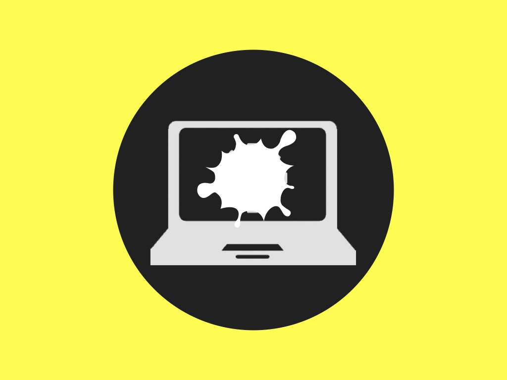
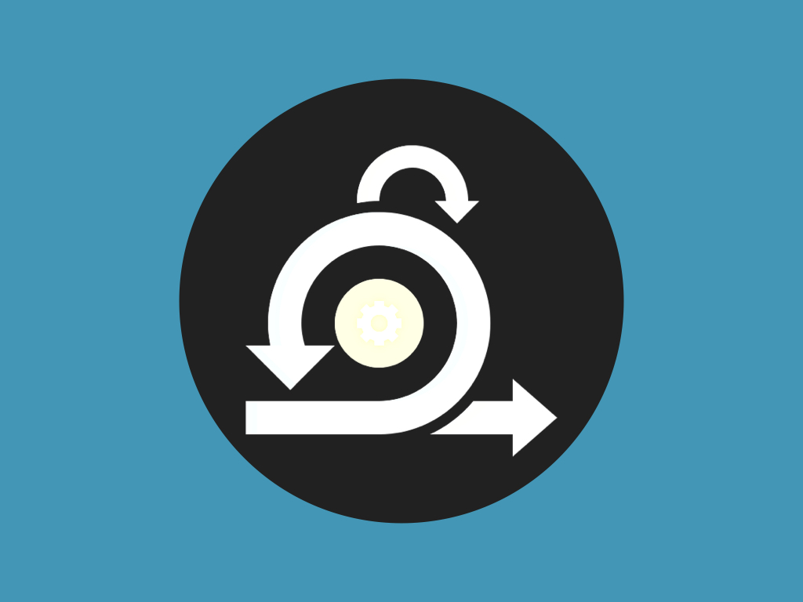
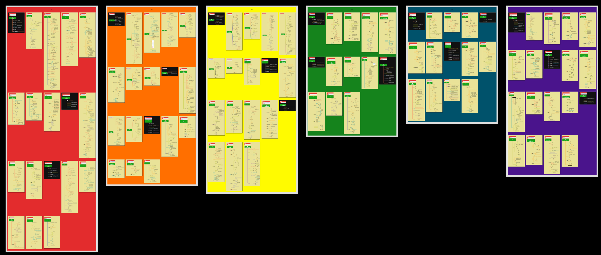

# 游戏开发 · 技术图谱

面向游戏程序员和技术负责人的系统化知识库：覆盖基础技术、游戏研发、规模化生产、团队管理与上线运营，并提供可运行代码、真实故障案例和 AI 协作记录。

  
  
  

[开始阅读](mds/阅读说明.md) · [文档索引](INDEX.md) · [交互式导航](https://gonglei007.github.io/GameDevMind/nav/) · [知识全景](https://gonglei007.github.io/GameDevMind/nav/panorama.html) · [English](https://github.com/gonglei007/GameDevMind-EN)

> 希望帮你在前人走过的路上节省时间，更快抓住关键问题、找到解决方向，把精力投入到真正有创造力的事情上。

<!-- BEGIN GENERATED:content-stats -->
| 📚 124 篇文档 | 💻 2 类代码示例 | 🏥 8 个实战案例 | 🤖 5 个 AI 对话 |
|:---:|:---:|:---:|:---:|
| [浏览文档](INDEX.md) | [运行代码](code/README.md) | [查看案例](cases/README.md) | [查看对话](ai-cases/README.md) |

文档统计覆盖 `mds/` 全部 Markdown：112 篇核心文档（含目录页）＋ 12 篇专题与说明。
<!-- END GENERATED:content-stats -->

## 从这里开始

不必从头读到尾。根据当前阶段选择一条路径，遇到具体问题时再通过索引或交互式导航深入。

| 推荐路径 | 适合谁 | 你将获得 | 入口 |
|---|---|---|---|
| **A · 新人入门线** | 在校生、转行者、0～1 年开发者 | 编程与软件工程基础、游戏技术全貌、可执行的学习顺序 | [开始学习](mds/topics/推荐阅读路径.md#路径-a新人入门线) |
| **B · 研发实战线** | 1～5 年客户端、服务端或全栈开发者 | 游戏专项技术、系统设计方法、性能与工程实践 | [进入实战](mds/topics/推荐阅读路径.md#路径-b研发实战线) |
| **C · 上线运营线** | 主程、技术负责人、CTO、准备上线的团队 | 生产效率、项目治理、发布运维和技术运营能力 | [准备上线](mds/topics/推荐阅读路径.md#路径-c上线运营线) |

还不确定从哪里开始？查看 [阅读说明](mds/阅读说明.md)、[关键词索引](KEYWORDS.md) 或 [常见问题](mds/topics/常见问题.md)。

## 六大核心能力域

六大能力按照游戏产品价值链组织，而不是简单按岗位或技术栈平铺：

每篇正文只有一个主归属，跨层关系通过专题路径、标签和关联链接表达。具体判定标准见 [知识结构分层规范](docs/知识结构分层规范.md)。

<table width="100%">
  <tr>
    <td width="50%" valign="top" align="center">
       
      <strong><a href="mds/1.基础能力/1.基础能力.md">1. 基础能力</a></strong> 
      语言 · 算法 · 数据结构 · 操作系统 · 软件工程  
      与游戏行业相关、但不限于游戏行业的编程、数学、计算机系统和软件工程基础。
    </td>
    <td width="50%" valign="top" align="center">
       
      <strong><a href="mds/2.技术能力/2.技术能力.md">2. 技术能力</a></strong> 
      渲染 · 物理 · 网络 · 音频 · 客户端与服务端  
      可跨游戏项目复用的图形、物理、UI、音频、引擎、网络和数据专项技术。
    </td>
  </tr>
  <tr>
    <td width="50%" valign="top" align="center">
       
      <strong><a href="mds/3.研发能力/3.研发能力.md">3. 研发能力</a></strong> 
      架构 · 场景 · 玩法系统 · 工具链 · 调试与优化  
      面向游戏产品本身的客户端、服务端、玩法、业务系统和运行时架构。
    </td>
    <td width="50%" valign="top" align="center">
       
      <strong><a href="mds/4.生产能力/4.生产能力.md">4. 生产能力</a></strong> 
      资源管线 · 自动化构建 · 质量保障 · 性能治理  
      围绕内容、数据、工具、自动化、技术中台和交付流水线建立工业化生产能力。
    </td>
  </tr>
  <tr>
    <td width="50%" valign="top" align="center">
       
      <strong><a href="mds/5.管理能力/5.管理能力.md">5. 管理能力</a></strong> 
      技术规划 · 团队协作 · 项目风险 · 研发效能  
      围绕角色、流程、目标、质量、版本、项目、团队和风险建立生产管理能力。
    </td>
    <td width="50%" valign="top" align="center">
       
      <strong><a href="mds/6.运营能力/6.运营能力.md">6. 运营能力</a></strong> 
      发布 · 监控 · 热更新 · 安全 · 数据与商业化  
      覆盖上线后的运维、LiveOps、数据分析、用户服务、商业化、安全、合规和持续盈利。
    </td>
  </tr>
</table>

## 知识全景

六大能力域并不是孤立的目录，而是一张彼此关联、持续扩展的游戏研运知识网络。

[打开交互式全景图](https://gonglei007.github.io/GameDevMind/nav/panorama.html) · [查看高清图谱总览](exports/0.总览.png)

## 可立即使用的资源

### 精选代码示例

所有示例均可本地运行，重点展示真实游戏场景中的设计取舍和效果差异。

| 示例 | 解决什么问题 | 可以观察什么 |
|---|---|---|
| [内存池](code/gamedevmind/1.基础能力/1.1.2.C++语言/memory_pool/) | 高频内存分配带来的开销 | `malloc` 与池化 10 万次性能对比 |
| [四叉树](code/gamedevmind/1.基础能力/1.2.2.数据结构/quadtree/) | 大量对象碰撞检测成本过高 | O(n²) 遍历与空间分区的差异 |
| [帧同步 vs 状态同步](code/gamedevmind/2.技术能力/2.2.1.网络与通信/network_sync/) | 多人游戏如何同步状态 | Lockstep 与 State Sync 本地模拟 |

[查看两类代码集合及全部示例](code/README.md)

### 精选实战案例

从症状出发，完整呈现定位过程、根因和解决方案。

| 案例 | 现场症状 | 最终根因 |
|---|---|---|
| [SLG 手游内存泄漏](cases/memory-leak-slg.md) | 挂机 2 小时后 OOM 崩溃 | `shared_ptr` 循环引用 |
| [MOBA 角色回弹复核](cases/network-reconciliation.md) | 移动预测与旧权威状态时点错配 | 输入确认、原 dt 重放与显示分离；历史效果未复核 |
| [开放世界卡顿](cases/drawcall-optimization.md) | Draw Call 高、野外卡顿的诊断练习 | 核对材质、合批与 UI 假设；产品根因待复测 |

[查看全部 8 个案例](cases/README.md)

### 精选 AI 协作记录

保留 Prompt、AI 输出、人工判断、修正过程和最终成果，展示 AI 如何真正参与研发。

| 对话 | 场景 | 关键结果 |
|---|---|---|
| [用 Claude 设计内存池](ai-cases/cpp-memory-pool.md) | C++ 服务器内存池 | 从初版迭代到 ARM 对齐修正 |
| [用 Cursor 优化 Draw Call](ai-cases/unity-drawcall-optimization.md) | Unity 性能优化 | 纠正 Static/MPB 建议，改为只读审计与回归 |
| [用 ChatGPT 设计缓存方案](ai-cases/go-leaderboard-cache.md) | Go 排行榜查询 | 纠正双写、TTL 与分页；完整快照和依赖回归 |

[查看全部 5 个 AI 对话](ai-cases/README.md) · [.cursorrules 游戏开发模板](.cursorrules.example) · [CLAUDE.md 项目记忆模板](CLAUDE.md.example)

## 延伸专题

| 专题 | 适合什么场景 | 入口 |
|---|---|---|
| **游戏程序员职业发展路径** | 从初级程序员到技术主管，理解不同阶段的职责、能力要求和学习资源 | [查看发展路径](mds/topics/游戏程序员职业发展路径.md) |
| **游戏研运资产样例 · SLG 手游（2D）** | 评估立项所需内容、成本、工作量和完整资产清单 | [查看资产样例](mds/游戏研运资产样例-SLG手游（2D）.md) |

## 参与与交流

发现问题、希望补充案例，或者有新的游戏开发实践想分享，欢迎通过以下入口参与。

| 方式 | 入口 |
|---|---|
| 参与完善 | [贡献指南](CONTRIBUTING.md) |
| 提问与讨论 | [GitHub Discussions](https://github.com/gonglei007/GameDevMind/discussions) |
| 深度文章 | [知乎专栏《游戏开发图谱》](https://www.zhihu.com/column/c_2015116242835482449) |
| QQ 群 | [242500383](https://qm.qq.com/cgi-bin/qm/qr?k=fy4Z65nE-5Jd1ay8FkJpDc9iPJyW3d38&jump_from=webapi) |
| 更新记录 | [HISTORY.md](HISTORY.md) |

<strong>贡献者</strong>

感谢所有为这个项目贡献内容、代码和建议的开发者：

[公雷](https://github.com/gonglei007) · [Atom](https://github.com/gameatom) · [管仲才](https://github.com/guanzhongcai) · [王栋](https://github.com/wangdng) · [KK](https://github.com/manchurio) · [陈运雄](https://github.com/chenyunxion) · [彭静](https://github.com/goddie) · [宋博](https://github.com/ax-jason) · [Hardy LYU](https://github.com/Colythme) · ……

<strong>项目路线图</strong>

| 方向 | 当前状态 |
|---|---|
| 多语言支持 | 规划中 |
| B 站 / YouTube 系列视频 | 规划中 |
| 交互式全景图 | 已上线 |
| 配套代码示例 | 已上线 |
| 实战案例库 | 已上线 |
| AI 实战对话 | 已上线 |
| 社区贡献体系 | 已上线 |

<strong>特别鸣谢</strong>

  
    
  

## 联系我们

**顶游社**是一家游戏研发技术中台，提供游戏开发技术咨询、团队培训和项目技术方案评估等服务。

| 方式 | 信息 |
|---|---|
| 官网 | [gltop.com](https://www.gltop.com?from=gamedevmind) |
| 邮箱 | [gonglei@gltop.com](mailto:gonglei@gltop.com) |
| 微信 |  |
| QQ 群 | [242500383](https://qm.qq.com/cgi-bin/qm/qr?k=fy4Z65nE-5Jd1ay8FkJpDc9iPJyW3d38&jump_from=webapi) |

持续更新中。欢迎 Star、Fork，或者提交你的第一个改进。

Powered by [顶游社](https://www.gltop.com?from=gamedevmind)

