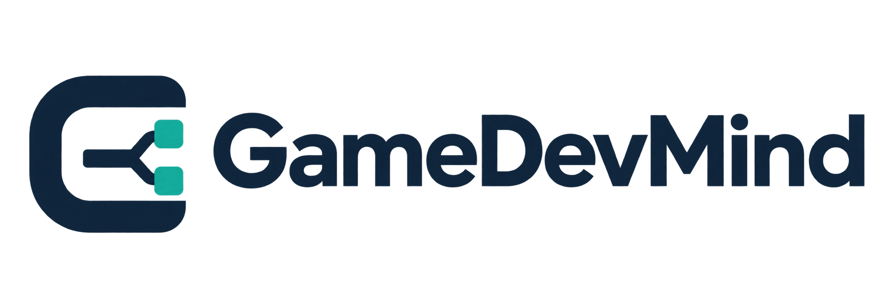
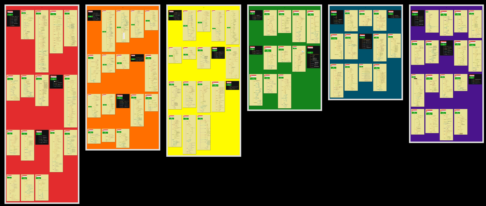

  

# 游戏开发 · 技术图谱

  <strong>从技术原理到游戏研运的系统化知识库</strong> 
  面向游戏程序员和技术负责人 · 代码示例 · 案例诊断 · AI 研发实践

  
  
  

[能力图谱](#六大核心能力域) · [工程实践](#ggframework-工程实践) · [AI 研发](#ai-研发与应用) · [示例与案例](#代码示例与诊断练习) · [参与交流](#参与与联系) · [English](https://github.com/gonglei007/GameDevMind-EN)

<!-- BEGIN GENERATED:content-stats -->
**📚 124 篇文档** · **💻 2 类代码示例** · **🏥 8 个案例与诊断练习** · **🤖 [AI 研发与应用](docs/AI/README.md)**（5 个协作记录）

文档数按 `mds/` 统计，详见 [统计口径](INDEX.md#统计口径)。
<!-- END GENERATED:content-stats -->

## 从这里开始

按当前任务进入，首次使用可先看 [阅读说明](mds/阅读说明.md)。

| 任务 | 推荐入口 |
|---|---|
| **系统学习** | [新人入门](mds/topics/推荐阅读路径.md#路径-a新人入门线) · [研发实战](mds/topics/推荐阅读路径.md#路径-b研发实战线) · [上线运营](mds/topics/推荐阅读路径.md#路径-c上线运营线) |
| **问题查找** | [文档索引](INDEX.md) · [关键词索引](KEYWORDS.md) · [交互式导航](https://gonglei007.github.io/GameDevMind/nav/) |
| **示例验证** | [代码示例](code/README.md) · [案例与诊断练习](cases/README.md) |
| **AI 研发** | [AI 研发与应用资料中心](docs/AI/README.md) |

## 六大核心能力域

沿着「基础 → 技术 → 研发 → 生产 → 管理 → 运营」定位所需知识。

<table width="100%" align="center">
  <tr>
    <td width="50%" valign="top" align="center">
      

      
<strong><a href="mds/1.基础能力/1.基础能力.md">1. 基础能力</a></strong>

      
语言 · 算法 · 数学 计算机与程序设计

    </td>
    <td width="50%" valign="top" align="center">
      

      
<strong><a href="mds/2.技术能力/2.技术能力.md">2. 技术能力</a></strong>

      
渲染 · 物理 · 音频 网络与数据技术

    </td>
  </tr>
  <tr>
    <td width="50%" valign="top" align="center">
      

      
<strong><a href="mds/3.研发能力/3.研发能力.md">3. 研发能力</a></strong>

      
客户端 · 服务端 架构与玩法系统

    </td>
    <td width="50%" valign="top" align="center">
      

      
<strong><a href="mds/4.生产能力/4.生产能力.md">4. 生产能力</a></strong>

      
管线 · 工具 · 自动化 内容生产与交付

    </td>
  </tr>
  <tr>
    <td width="50%" valign="top" align="center">
      

      
<strong><a href="mds/5.管理能力/5.管理能力.md">5. 管理能力</a></strong>

      
规划 · 团队 · 项目 质量与协作流程

    </td>
    <td width="50%" valign="top" align="center">
      

      
<strong><a href="mds/6.运营能力/6.运营能力.md">6. 运营能力</a></strong>

      
发布 · 运维 · 数据 安全与商业化

    </td>
  </tr>
</table>

[交互式知识全景](https://gonglei007.github.io/GameDevMind/nav/panorama.html) · [高清图谱总览](exports/0.总览.png) · [知识分层说明](docs/知识结构分层规范.md)

<strong>展开知识全景预览</strong>

## GGFramework：把知识点放进真实工程

通过作者维护的 Unity Demo，把状态、资源、网络、UI、SDK 与 Lua 放进同一工程观察：先运行，再沿调用理解模块协作与释放责任。

**[GGFramework 实践导读](docs/工程实践/GGFramework.md)** · **[运行 Demo 与查看验证记录](docs/工程实践/GGFrameworkUnity验证记录.md)**

- [Core 基础能力实践](docs/工程实践/GGFrameworkCore基础能力实践.md) · [资源管理实践](docs/工程实践/GGFramework资源管理实践.md)：状态、事件、对象池与资源归属。
- [客户端网络实践](docs/工程实践/GGFramework客户端网络实践.md) · [UI 管理实践](docs/工程实践/GGFrameworkUI管理实践.md)：请求恢复、页面栈与关闭责任。
- [用户与 SDK 接入实践](docs/工程实践/GGFramework用户与SDK接入实践.md) · [Lua 与热更新实践](docs/工程实践/GGFrameworkLua与热更新实践.md)：渠道适配、脚本互调与验证边界。

适用条件与验证边界见导读；重复执行步骤见[自动化回归与 CI 复现](docs/工程实践/GGFramework自动化回归与CI.md)。

## AI 研发与应用

<table width="100%">
  <tr>
    <td width="32%" valign="middle" align="center">
      
    </td>
    <td valign="middle">
      
<strong>与 AI 协作推进游戏研发</strong>

      
《AI游戏开发》六篇实践手册，串起决策、执行与验证，配合协作复核、工程模板与应用专题查阅。

      
<strong><a href="docs/AI/README.md">进入资料中心 →</a></strong>

    </td>
  </tr>
</table>

## 代码示例与诊断练习

[全部代码示例](code/README.md) · [全部案例与诊断练习](cases/README.md)

<strong>展开精选示例与案例</strong>

| 精选入口 | 可以核对什么 |
|---|---|
| 代码 · [内存池](code/gamedevmind/1.基础能力/1.1.2.C++语言/memory_pool/) | 分配策略与开销演示 |
| 代码 · [客户端网络生命周期](code/gamedevmind/3.研发能力/3.1.4.客户端网络系统/client_network/) | 旧回调隔离、取消与重连恢复 |
| 案例 · [SLG 循环引用](cases/memory-leak-slg.md) | 强弱引用与对象生命周期 |
| 案例 · [MOBA 角色回弹复核](cases/network-reconciliation.md) | 输入确认、重放与显示校正 |
| 代码 · [四叉树](code/gamedevmind/1.基础能力/1.2.2.数据结构/quadtree/) | 空间分区与碰撞候选查询 |
| 代码 · [帧同步 vs 状态同步](code/gamedevmind/2.技术能力/2.2.1.网络与通信/network_sync/) | Lockstep 与预测校正的本地模型 |
| 案例 · [开放世界卡顿复核](cases/drawcall-optimization.md) | 材质、合批与 UI 假设的诊断练习 |

延伸阅读：[职业发展路径](mds/topics/游戏程序员职业发展路径.md) · [SLG 手游研运资产样例](mds/游戏研运资产样例-SLG手游（2D）.md) · [常见问题](mds/topics/常见问题.md)

## 参与与联系

| 方式 | 入口 |
|---|---|
| 参与完善 | [贡献指南](CONTRIBUTING.md) · [更新记录](HISTORY.md) |
| 提问与交流 | [GitHub Discussions](https://github.com/gonglei007/GameDevMind/discussions) · [QQ 群 242500383](https://qm.qq.com/cgi-bin/qm/qr?k=fy4Z65nE-5Jd1ay8FkJpDc9iPJyW3d38&jump_from=webapi) |
| 深度文章 | [知乎专栏《游戏开发图谱》](https://www.zhihu.com/column/c_2015116242835482449) |
| 技术咨询与培训 | [顶游社](https://www.gltop.com?from=gamedevmind) · [gonglei@gltop.com](mailto:gonglei@gltop.com) |

<strong>邮箱联系、项目资料、贡献者与鸣谢</strong>

感谢所有贡献内容、代码和建议的开发者：

[公雷](https://github.com/gonglei007) · [Atom](https://github.com/gameatom) · [管仲才](https://github.com/guanzhongcai) · [王栋](https://github.com/wangdng) · [KK](https://github.com/manchurio) · [陈运雄](https://github.com/chenyunxion) · [彭静](https://github.com/goddie) · [宋博](https://github.com/ax-jason) · [Hardy LYU](https://github.com/Colythme) · ……

后续计划：多语言支持、B 站 / YouTube 系列视频。已有内容及进展见上方入口和更新记录。

邮箱联系：[gonglei@gltop.com](mailto:gonglei@gltop.com)

特别鸣谢：

