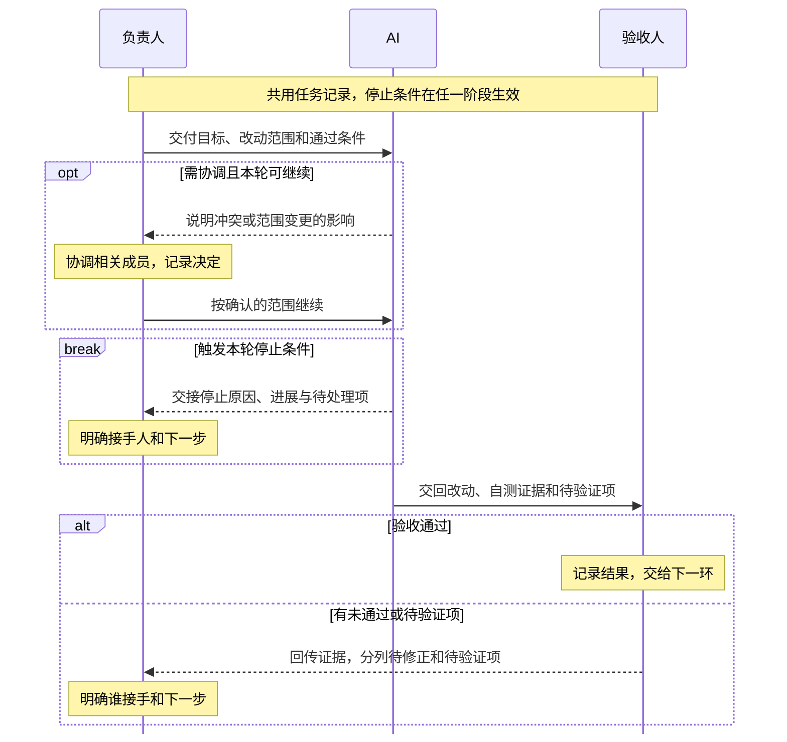

# 协作与决策原则

[返回手册目录](README.md) · [下一篇 系统设计与架构](02.系统设计与架构.md)

**读完本篇，你可以**把一个模糊想法写成可以交给 AI 的任务，明确哪些决定由人工做、要交付什么、怎样验收。手上已有任务时，可从[任务交接模板](#任务交接模板)开始。

## 团队如何与 AI 配合

整理补充。每轮明确一位**负责人**和一位**验收人**，共用一份任务记录。团队成员按确认的接口衔接，意见冲突或改动范围需要调整时，由负责人协调并记录决定。

个人或小团队可由同一人兼任负责人和验收人。填写[任务交接模板](#任务交接模板)。多人同时修改同一模块时，查阅[已有改动与并行工作](03.开发与迭代流程.md#已有改动与并行工作)。

## 人机决策分工

多问。问 AI 有什么建议，由人做出判断和决定，再让 AI 落地。

来源：个人经验（用户记录）。

### 重要决策前比较多个方案

做重要决策前，让 AI 给出多个方案，说明各自的优缺点和适用场景，再由人工选择，让 AI 执行。

来源：个人经验（用户记录）。

决策责任（整理补充）：技术选型、模块职责和[接口取舍](02.系统设计与架构.md#接口契约与变更约束)由人工确定，AI 提供候选方案并按决策实现。具体设计方法见[系统设计与架构](02.系统设计与架构.md)。

## 上下文整理与任务交接

整理补充：每轮任务开始时提供当前项目状态；换聊天或交接工作前更新记录，让 AI 根据现状继续执行。

交接内容按下方模板记录；完成标准及预算／停止条件按[第三篇的约定](03.开发与迭代流程.md#完成标准与停止条件)填写或引用，长期约束引用相应项目文档。

### 任务交接模板

- **负责人和验收人**。写明由谁协调决定、由谁核对通过条件和验证证据。

- **项目与版本**：仓库、分支、提交标识、[未提交改动及其任务归属](03.开发与迭代流程.md#已有改动与并行工作)和运行入口。

- **当前进展**：已完成事项、当前进行的工作、其余未完成事项与已知问题。

- **决策记录**：已确认方案写清采用的方案、原因及相关文档；待人工决定事项列明候选选项、影响及阻塞的后续工作。

- **下一步目标与接手人**。写明下一步要做的小目标和允许修改的范围。需要转交时，由负责人明确接手人和接续步骤。

- **完成标准**：本轮要解决的问题、交付物及验收通过条件，可引用当前任务约定。

- **预算与停止条件**：本轮可用或剩余的时间、迭代次数等预算，以及需要停止并汇报的情形。

- **验证方法与结果**。记录启动和检查方法、人工验收范围、结果与证据。检查已执行且未达标准时记为「未通过」，写明待修正和复测的内容。检查尚未执行或尚无结论时记为「待验证」，写明需补做的检查或需补充的证据。

让 AI 先阅读记录并核对实际代码与环境；发现记录与现状不一致时，说明差异后按确认的现状推进。

#### 按任务影响选择协作方式

整理补充。先判断改动会影响谁、能否快速验证、出了问题是否容易恢复。改动行数只反映实现规模，改一个存档字段也可能影响整个版本。

| 任务情形 | 开工前写清什么 | 交付前检查什么 |
|---|---|---|
| 局部、易验证的改动，如修正一处菜单文案 | 目标文件、预期文案、要核对的界面。一个目标加一条验收条件通常足够 | 对照差异和受影响界面 |
| 可拆成小目标的功能，如增加单机关卡暂停 | 写清目标、改动范围、完成标准和停止条件。涉及模块协作时，补上状态归属与接口行为 | AI 自测和约定的人工试玩，记录受影响的既有行为 |
| 影响多个模块、难回退或依赖真实环境，如迁移旧存档、改变联机协议、优化目标设备卡顿 | 先给 AI 现状和证据，让它比较方案。由人工确认兼容、迁移、回退和验证要求后，再划定实施范围 | 用旧数据、真实依赖或目标设备验证，保留版本、操作、预期与实际结果 |

上一轮留下未确认的设计决策，或当前环境跑不了关键检查时，先解决阻塞或安排交接。跨模块代码审查可使用[完整的代码优化提示词](04.可复用提示词.md#代码设计优化目标提示词)。

#### 示例 填写暂停任务

整理补充。以下用[假设项目的暂停功能](03.开发与迭代流程.md#示例-验收暂停功能)演示怎样写第一轮任务。实际交接时，按上面的模板附上项目版本和运行入口。

- **负责人和验收人**。玩法程序员负责协调改动，负责本关卡的测试人员试玩并验收。
- **小目标与范围**。接入关卡的暂停状态，让玩家能暂停和恢复角色控制。本轮只改暂停状态和角色控制，敌人、弹体、计时与菜单留给后续任务。
- **完成标准**。交付本轮代码和检查记录。暂停期间角色不移动、不射击，恢复后移动和射击都能正常使用。
- **预算与停止条件**。本轮限时 30 分钟。超时，或发现必须修改范围外的模块才能继续时，记录原因和进展，交接后停止。
- **验证方法**。AI 先检查暂停前、中、后的角色位置和射击事件。人工在关卡中边移动边射击，切换暂停和恢复两次，确认输入在暂停时不生效，恢复后正常响应。
- **交付记录与下一步**。列出改动和实际检查结果。若自测发现暂停时仍能射击，将该检查记为「未通过」，由玩法程序员接手修正并安排复测。若尚未试玩，将人工试玩记为「待验证」，由关卡测试人员接手补做。
