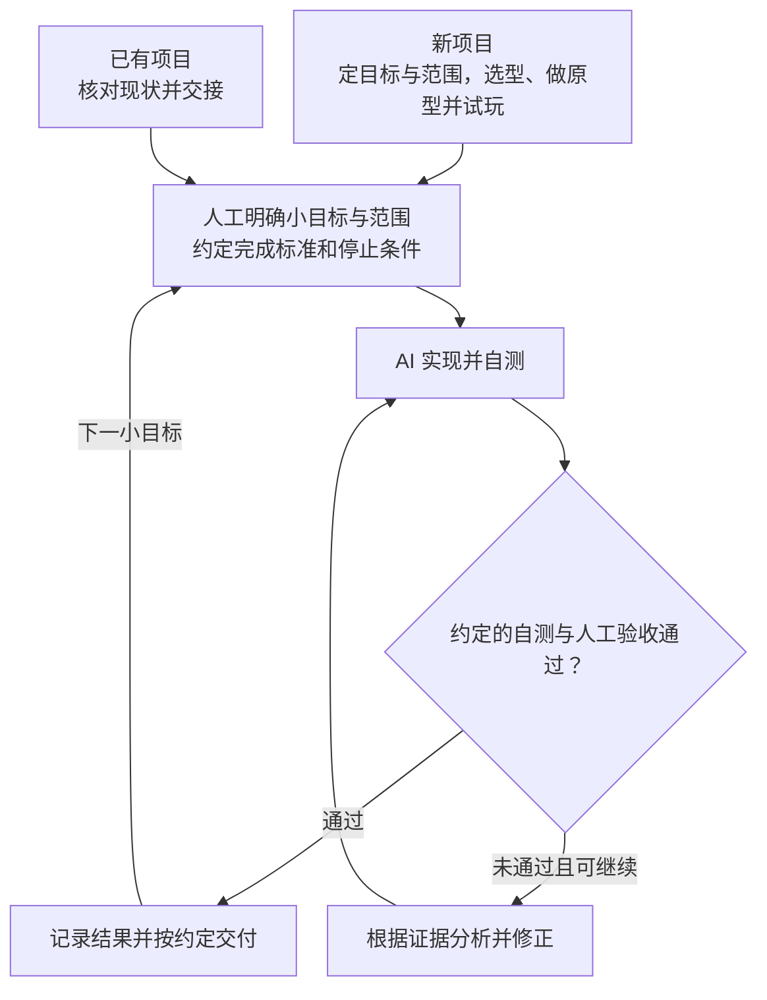
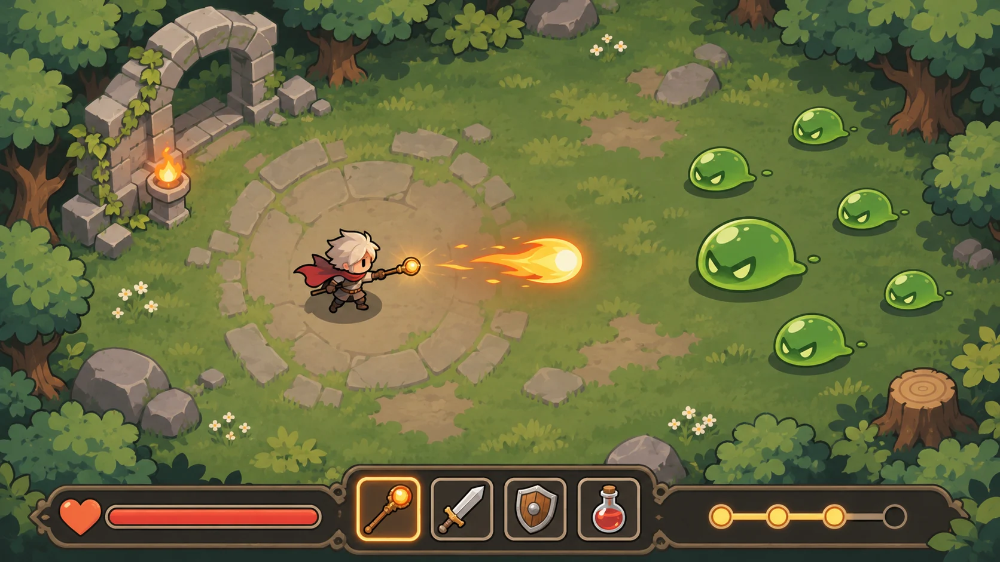

# AI 游戏开发

[返回 AI 研发与应用资料中心](../AI/README.md)

这份手册面向使用 AI 辅助游戏开发的个人与小团队，提供人工决策、AI 执行和实践验证的方法。现已收录个人经验、方法说明、可复用提示词、说明性示例和带验证证据的项目复盘。

## 怎么读这本书

整理补充。想了解一个功能从想法到试玩的全过程，可以先[沿着火球技能读](#沿着火球技能读)，再用[六篇目录](#系列阅读目录)查各环节的方法。手上已有项目，可以从[第一次怎么用](#第一次怎么用)或[按任务查找](#按任务查找)直接开始。

### 沿着火球技能读

在[假设的俯视角波次生存游戏](#共用示例背景)里，我们要做一个火球技能。带着同一个问题读下面四步：玩家在移动中施放时，怎样知道火球有没有放出来，最后有没有打中？

1. **把想法变成一项任务。** 明确体验目标、这轮允许改动的范围和试玩时要观察的现象，由人工确认取舍。[项目目标与范围](03.开发与迭代流程.md#项目目标与范围) · [任务交接模板](01.协作与决策原则.md#任务交接模板)
2. **约定模块怎样协作。** 对齐释放、拒绝、未命中和命中的含义，再明确哪个模块更新魔法、冷却和目标状态。[火球模块边界与状态归属](02.系统设计与架构.md#火球模块边界与状态归属)
3. **先做可玩版本，再分工整合。** 用占位弹体验证飞行和反馈。程序交付规则实现，UI 和美术交付反馈样例。[从目标到火球技能试玩](03.开发与迭代流程.md#示例-从目标到火球技能试玩)
4. **根据证据结束本轮或继续迭代。** AI 自测规则与状态，人工试玩确认反馈能否被理解。记录结果，再决定交付或回到交互、表现或玩法继续修改。[测试与验收](03.开发与迭代流程.md#测试与验收) · [试玩反馈与设计迭代](03.开发与迭代流程.md#试玩反馈与设计迭代)

## 第一次怎么用

整理补充：按当前任务选择起点，可以边做边查，无需先读完六篇。

- **尚无项目**。依次[明确目标与最小范围](03.开发与迭代流程.md#项目目标与范围)、[比较选型方案](02.系统设计与架构.md#技术选型的比较与验证)、[制作原型](03.开发与迭代流程.md#准备环境与验证原型)并[试玩验证](03.开发与迭代流程.md#试玩反馈与设计迭代)。
- **已有项目**。[按任务影响选择协作方式](01.协作与决策原则.md#按任务影响选择协作方式)，按需填写[交接模板](01.协作与决策原则.md#任务交接模板)。第一次写任务时，可参考[填好的暂停任务](01.协作与决策原则.md#示例-填写暂停任务)。

开始一轮任务前，约定[完成标准与停止条件](03.开发与迭代流程.md#完成标准与停止条件)。任何阶段触发停止条件时，停止本轮工作并交接，记录当前进展、待验证项和接续步骤。

把目标、允许修改的范围、验收条件及相关文件或片段交给 AI。使用能读取仓库的工具时注明文件路径。重要方案由人工选择后再实现。

AI 自测与人工验证按[测试与验收](03.开发与迭代流程.md#测试与验收)执行。AI 无法执行检查时，按[受限检查的处理方式](03.开发与迭代流程.md#ai-无法执行检查时)安排人工执行并回传结果。验收通过后，按[提交规范](03.开发与迭代流程.md#提交规范)和本轮约定的[交付范围](03.开发与迭代流程.md#提交推送pr-合并与发布)交付。

## 系列阅读目录

前三篇依次讲怎样分工、怎样设计和怎样交付。后三篇可在实际任务中查阅。

1. [协作与决策原则](01.协作与决策原则.md)。把想法写成 AI 可以接手的任务，约定人工决策和验收责任。
2. [系统设计与架构](02.系统设计与架构.md)。比较技术方案，明确模块边界、接口契约、数据与状态归属。
3. [开发与迭代流程](03.开发与迭代流程.md)。把功能从原型推进到实现、排错、试玩和版本交付。
4. [可复用提示词](04.可复用提示词.md)。按任务范围选用交接模板，或复制完整的代码优化提示词。
5. [项目案例与复盘](05.项目案例与复盘.md)。对照真实失败、修复提交和回归证据，理解工程取舍。
6. [积累与维护](06.积累与维护.md)。用模板记录经验，提炼可复用能力，并查阅手册维护约定。

## 按任务查找

以下导航为整理补充，直接引用正文中的主要维护位置。

- **开始新项目**：[确定目标与阶段](03.开发与迭代流程.md#确定目标与阶段) → [技术选型比较与验证](02.系统设计与架构.md#技术选型的比较与验证) → [验证原型](03.开发与迭代流程.md#准备环境与验证原型)。
- **让 AI 接手任务**：[团队配合与交接](01.协作与决策原则.md#团队如何与-ai-配合) → [模块边界](02.系统设计与架构.md#清晰接口与模块边界) → [完成标准与停止条件](03.开发与迭代流程.md#完成标准与停止条件) → [验收范围与完成状态](03.开发与迭代流程.md#验证范围与完成状态)。
- **实现一个新功能**。涉及玩法、UI 和表现协作时，先看[按角色分工推进一个功能](03.开发与迭代流程.md#按角色分工推进一个功能)。每轮按[明确功能与验收条件](03.开发与迭代流程.md#完成标准与停止条件) → [确定模块与接口](02.系统设计与架构.md#模块设计记录) → [小步实现](03.开发与迭代流程.md#小步迭代验证通过后再继续) → [测试与人工验收](03.开发与迭代流程.md#测试与验收)推进。
- **设计或调整模块接口**：[接口契约与变更约束](02.系统设计与架构.md#接口契约与变更约束) → [模块设计记录](02.系统设计与架构.md#模块设计记录) → [测试与验收](03.开发与迭代流程.md#测试与验收)。
- **审查与优化代码**：[明确范围与完成标准](03.开发与迭代流程.md#小步迭代验证通过后再继续) → [代码设计优化提示词](04.可复用提示词.md#代码设计优化目标提示词) → [回归检查](03.开发与迭代流程.md#回归检查与验收证据) → [验收与完成状态](03.开发与迭代流程.md#验证范围与完成状态)。
- **调整架构**：[模块职责](02.系统设计与架构.md#技术选型与模块职责) → [架构图与持续优化](02.系统设计与架构.md#持续优化架构用架构图辅助分析) → [方案比较与人工决策](01.协作与决策原则.md#重要决策前比较多个方案)。
- **制作 UI 与资源**：[风格规范与样例确认](03.开发与迭代流程.md#ui-与美术制作)。
- **遇到故障**：[收集证据与分析原因](03.开发与迭代流程.md#先收集证据再分析原因)；参考示例：[暂停恢复故障](03.开发与迭代流程.md#示例-定位恢复后怪物停滞)。
- **遇到性能问题**：[基线测量与瓶颈定位](03.开发与迭代流程.md#性能测量与优化) → [小步优化](03.开发与迭代流程.md#小步迭代验证通过后再继续) → 同条件复测与[回归检查](03.开发与迭代流程.md#回归检查与验收证据)。
- **验证代码与体验**：[回归检查与验收证据](03.开发与迭代流程.md#回归检查与验收证据) → [试玩反馈与设计迭代](03.开发与迭代流程.md#试玩反馈与设计迭代)。
- **练习暂停与恢复验证**：[暂停功能验收](03.开发与迭代流程.md#示例-验收暂停功能) → [Unity 小场景与验收对照](examples/unity-pause/README.md)。
- **AI 无法运行检查**：[说明受限原因、安排执行与回传](03.开发与迭代流程.md#ai-无法执行检查时) → [记录检查结果与完成状态](03.开发与迭代流程.md#验证范围与完成状态)。
- **准备交付**：[验收完成状态](03.开发与迭代流程.md#验证范围与完成状态) → [提交、推送与 PR 合并](03.开发与迭代流程.md#提交推送pr-合并与发布) → [构建与发布验证](03.开发与迭代流程.md#构建与发布验证)。
- **记录新经验**：[简短经验模板](06.积累与维护.md#简短经验模板)；归类未明时先放[待整理区](06.积累与维护.md#待整理区)，真实项目使用[完整案例模板](06.积累与维护.md#完整案例模板)。
- **提炼与共享 AI 能力**：[选择、提炼、验证与持续更新](06.积累与维护.md#持续提炼并共享-ai-能力)。

## 共用示例背景

整理补充：方法篇的六组说明性示例围绕同一款假设的俯视角波次生存游戏展开，包含移动射击、关卡波次、技能、装备界面和暂停功能。它们用于说明做法与取舍，尚未作为真实项目案例验证。

*假设项目示意图，由 AI 生成。*

火球技能已串入[导读](#沿着火球技能读)。其余示例可按当前任务选读。

- **原型与制作**。[验证移动与射击](03.开发与迭代流程.md#示例-验证移动与射击体验) · [用配置新增关卡](02.系统设计与架构.md#示例-用配置新增关卡) · [扩展 UI 与资源](03.开发与迭代流程.md#示例-从装备界面样例扩展-ui-与资源)
- **验收与排查**。[验收暂停功能](03.开发与迭代流程.md#示例-验收暂停功能) · [定位恢复故障](03.开发与迭代流程.md#示例-定位恢复后怪物停滞)

## 维护入口

- 仓库 Markdown 是唯一维护来源。本页维护导读、首次使用指引、篇目顺序和任务导航，跨篇内容链接到正文。
- 新增内容保留个人经验原意，分别标注个人经验、整理补充和外部资料。经验验证状态单独记录。详见[维护规则](06.积累与维护.md#手册新增内容整理规则)和[更新记录](06.积累与维护.md#更新记录)。
- 专题外[旧路径入口](../AI游戏开发手册.md)保留为导航。
