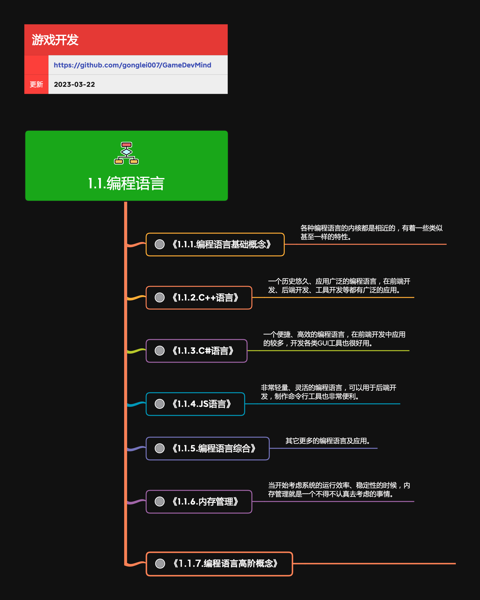

## 编程语言

不同的编程语言有着不同的特长和优势，在游戏开发中，可能会用到不同的编程语言。
编程语言是游戏开发最最基础的工具，工具用的好，对于整体产品开发会有事半功倍的效果。

**关键词:** 
*C++,C#,JS*

**标签:** 
*等级: 入门|初级, 阶段: 学习, 分类: 基础能力, 角色: 客户端开发|服务端开发|全栈开发*

[返回上一级](1.基础能力.md)

## 按任务找入口

| 我想解决的问题 | 先看 |
|---|---|
| 第一次学语言，先弄懂类型、控制流和函数 | [编程语言基础概念](1.1.1.编程语言基础概念.md) |
| 需要编写 Unity 脚本或 C# 项目 | [C#语言](1.1.3.C%23语言.md) |
| 对象意外存活，排查内存分配与所有权 | [内存管理](1.1.6.内存管理.md) 配套：[SLG 循环引用案例](../../cases/memory-leak-slg.md) |

## 目录

<!-- BEGIN GENERATED:section-index -->
- [编程语言基础概念](1.1.1.编程语言基础概念.md)
- [C++语言](1.1.2.C++语言.md)
- [C#语言](1.1.3.C%23语言.md)
- [JS语言](1.1.4.JS语言.md)
- [编程语言综合](1.1.5.编程语言综合.md)
- [内存管理](1.1.6.内存管理.md)
- [编程语言高阶概念](1.1.7.编程语言高阶概念.md)
<!-- END GENERATED:section-index -->

## 图谱

展开编程语言图谱

