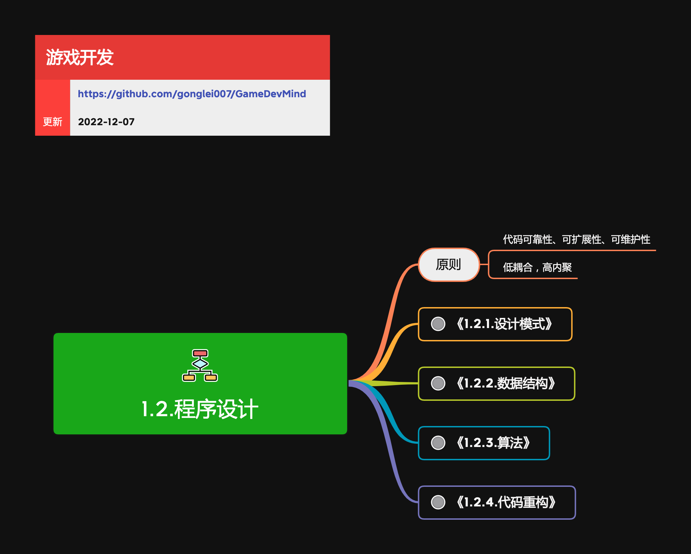

## 程序设计

程序设计，是软件开发人员最重要的基本功。做任何软件开发，都需要有优秀的设计能力。设计的够好，整个团队的开发效率就越高，维护软件的成本就越底。

**关键词:** 
*UML*

**标签:** 
*等级: 中级, 阶段: 学习|开发, 分类: 基础能力, 角色: 客户端开发|服务端开发|全栈开发*

[返回上一级](1.基础能力.md)

## 按任务找入口

| 我想解决的问题 | 先看 |
|---|---|
| 容器选不定，先比较访问、插入和查询成本 | [数据结构](1.2.2.数据结构.md) |
| 数据量上来后运行变慢，估算算法开销 | [算法](1.2.3.算法.md) |
| 修改一处牵连多处，先建立安全的重构步骤 | [代码重构](1.2.4.代码重构.md) |

## 目录

<!-- BEGIN GENERATED:section-index -->
- [设计模式](1.2.1.设计模式.md)
- [数据结构](1.2.2.数据结构.md)
- [算法](1.2.3.算法.md)
- [代码重构](1.2.4.代码重构.md)
<!-- END GENERATED:section-index -->

## 图谱

展开程序设计图谱

