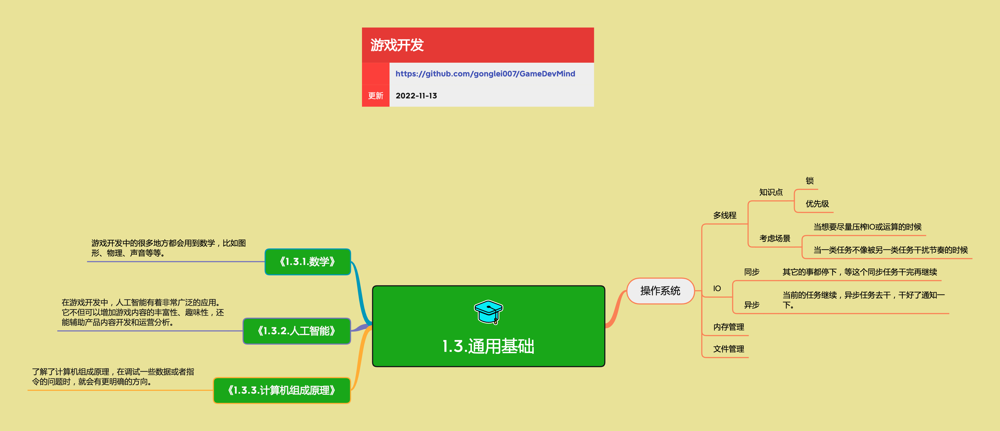

## 通用基础

无论前后端，还是工具开发，都可能会用到的基础知识与技术。

**关键词:** 
*网络,操作系统,计算机原理*

**标签:** 
*等级: 初级|中级, 阶段: 学习, 分类: 基础能力, 角色: 客户端开发|服务端开发|全栈开发*

[返回上一级](1.基础能力.md)

## 按任务找入口

| 我想解决的问题 | 先看 |
|---|---|
| 做坐标变换、插值或空间计算 | [数学](1.3.1.数学.md) |
| 理解进程、线程、调度与内存 | [操作系统](1.3.3.操作系统.md) |
| 从协议分层理解连接、传输和寻址 | [计算机网络](1.3.5.计算机网络.md) |

## 目录

<!-- BEGIN GENERATED:section-index -->
- [数学](1.3.1.数学.md)
- [人工智能基础](1.3.2.人工智能.md)
- [操作系统](1.3.3.操作系统.md)
- [计算机组成原理](1.3.4.计算机组成原理.md)
- [计算机网络](1.3.5.计算机网络.md)
<!-- END GENERATED:section-index -->

## 图谱

展开通用基础图谱

