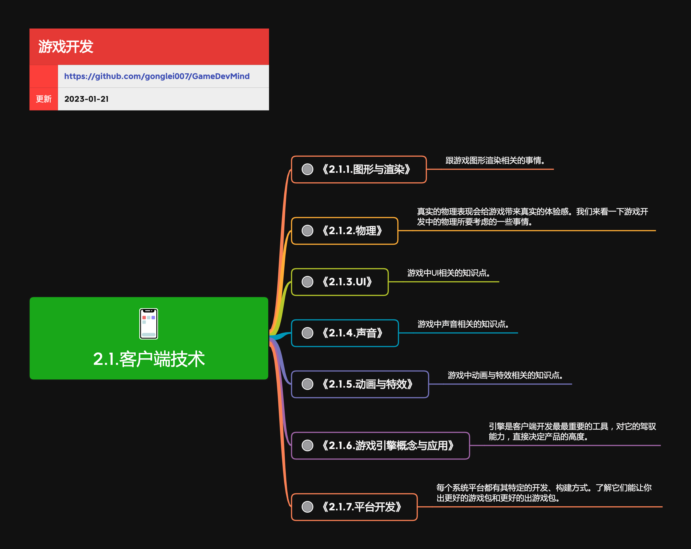

## 客户端技术

游戏客户端开发高频使用、可跨项目复用的专项技术。这里介绍技术原理、能力边界与选型；具体产品中的客户端系统架构归入研发能力。

**关键词:** 
*对象,数据*

**标签:** 
*等级: 初级|中级, 阶段: 学习|开发, 分类: 技术能力, 角色: 客户端开发*

[返回上一级](2.技术能力.md)

## 按任务找入口

| 我想解决的问题 | 先看 |
|---|---|
| 比较渲染方案，理解图形管线 | [图形与渲染](2.1.1.图形与渲染.md) |
| 为目标平台和团队选择引擎 | [游戏引擎概念与应用](2.1.6.游戏引擎概念与应用.md) |
| 核对引擎自带的运行时功能 | [游戏引擎功能系统](../4.生产能力/4.1.3.引擎的基本功能系统.md) |

## 目录

<!-- BEGIN GENERATED:section-index -->
- [图形与渲染](2.1.1.图形与渲染.md)
- [物理](2.1.2.物理.md)
- [UI](2.1.3.UI.md)
- [声音](2.1.4.声音.md)
- [动画与特效](2.1.5.动画与特效.md)
- [游戏引擎概念与应用](2.1.6.游戏引擎概念与应用.md)
- [平台开发](2.1.7.平台开发.md)
- [游戏引擎功能系统](../4.生产能力/4.1.3.引擎的基本功能系统.md)
- [游戏引擎支撑与扩展系统](../4.生产能力/4.1.4.引擎的其它系统.md)
<!-- END GENERATED:section-index -->

> UI、网络、渲染等技术在产品中的系统化实现，参见 [3.1.客户端产品研发](../3.研发能力/3.1.客户端产品研发.md)。

## 图谱

展开客户端技术图谱

