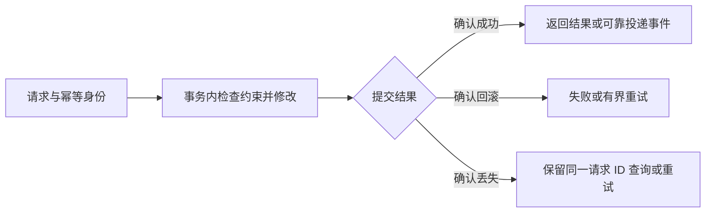

## 数据库

数据库选型先回答：哪些数据是权威事实、哪些业务不变量必须共同提交、允许读到多旧的结果，以及数据丢失后如何恢复。关系/文档模型、内嵌/服务部署、缓存/权威用途是不同维度，不能把数据库简单分为“缓存类”和“非缓存类”后直接选型。

**关键词:**<br/>
*数据库,SQL,MySQL,InnoDB,SQLite,MongoDB,Redis,SQL Server,数据模型,主键,唯一约束,索引,事务,隔离级别,MVCC,更新丢失,不可重复读,幻读,幂等,连接池,读写分离,缓存一致性,Schema更新,备份与恢复,RPO,RTO,执行计划,AI Coding*

**标签:**<br/>
*等级: 中级, 阶段: 学习|开发, 分类: 技术能力, 角色: 服务端开发|运维*

**适用范围：** 通用数据建模、事务与一致性、查询和运维决策。SQL 并发示例限定 MySQL 8.0/InnoDB；SQLite 示例为 Python 标准库本地教学，不能替代 InnoDB 行为验证。MongoDB、Redis 的保证须结合具体版本、拓扑、读写配置与故障模型。

**最近复核：** 2026-10-16。本文给出方案和验收计划，不提供未经测量的性能提升、容量或恢复时间。游戏服的数据对象、配置与业务组织见 [服务端产品研发](../3.研发能力/3.2.服务端产品研发.md)，容量诊断见 [服务端优化](../3.研发能力/3.2.3.服务端优化.md)。

## 目录

- [适用条件](#适用条件)
- [方案取舍](#方案取舍)
- [不适用场景](#不适用场景)
- [通用原理与一致性](#通用原理与一致性)
- [关系数据库与 SQL](#关系数据库与-sql)
- [NoSQL 与缓存](#nosql-与缓存)
- [性能与高可用](#性能与高可用)
- [验证方法](#验证方法)
- [AI Coding 指南](#ai-coding-指南)
- [延伸实践](#延伸实践)
- [更多资料](#更多资料)

> 配套：[排行榜案例复核](../../cases/leaderboard-optimization.md)、[SQLite 存档与排行榜](../../code/artile-sample-code/02-technical/06-database/)、[MySQL 事务契约](../../code/gamedevmind/2.技术能力/2.2.2.数据库/transaction_contract/)。AI 协作原则见 [阅读说明](../阅读说明.md#ai-coding-总览)。

## 适用条件

| 先明确什么 | 需要形成的约束 | 缺失时先做什么 |
|------|------|------|
| 权威源与不变量 | 余额/库存非负、总量、唯一订单、同分次序、哪些记录必须一起提交 | 写出成功、失败、重试与结算的判定规则 |
| 访问模式 | 按 ID、区服、时间或范围查询；关联、热点、写入和数据增长 | 列出实际 SQL/文档查询、结果大小与索引候选 |
| 一致性与持久性 | 是否要求 read-your-writes、跨行一致快照、允许陈旧和可丢失范围 | 不用“强一致”一个词代替读写配置、故障与事务边界 |
| 运行环境 | 引擎/版本、驱动、部署拓扑、延迟、连接预算、团队能力与许可 | 固定候选环境做原型；本地文件库与网络服务分别验证 |
| 演进与恢复 | 数据量、旧版本兼容、迁移窗口、RPO/RTO、恢复负责人 | 先设计迁移/备份和隔离恢复环境，再发布破坏性变更 |

## 方案取舍

| 方案 | 适用条件 | 代价与限制 | 验证重点 |
|------|------|------|------|
| 关系库（如 MySQL / SQL Server） | 关系、约束、跨行事务和多种查询明确 | 索引/事务有写入与锁成本，扩展需看热点；默认隔离不是所有业务的完整保护 | 约束、并发不变量、计划、持久化与故障恢复 |
| SQLite | 本地存档、工具、小型内嵌数据和教学原型 | 无独立数据库服务；写入串行，不能把 WAL 当多写者并行或 MySQL 行锁 | 文件生命周期、独立连接、busy/事务、备份与版本兼容 |
| MongoDB | 以有界文档聚合访问、字段演进和嵌入关系合适 | 文档仍需约束、索引和迁移；跨文档事务/分片有成本 | 单文档原子边界、读写关注、文档增长和跨文档操作 |
| Redis 缓存/派生索引 | 可重建的热点、小值与有界陈旧展示 | 内存、淘汰、持久化配置、源年龄和故障回源；不能默认是权威事务库 | 缺 key/空值、完整发布、并发失效、重建与最大年龄 |
| 主库 + 只读副本 | 读负载可分散，部分读取容忍复制延迟 | 路由、延迟和故障切换语义更复杂；不自动保证刚写即读 | 主/副本读契约、复制进度、切换与降级 |
| 分片 / 多存储组合 | 单节点瓶颈已证实、分区键与迁移可控 | 跨分片事务、全局唯一、热点、对账与运维复杂度 | 重平衡、部分故障、跨分区查询和一致性 |

这不是按游戏类型固定配库的清单。SQL Server 的平台和许可、各产品的容量和支持范围应按所用版本核对；不能把团队使用 Windows 或 .NET 当成唯一选型依据。

## 不适用场景

| 不应直接采用 | 原因 | 改为 |
|------|------|------|
| “用了事务，就不会并发覆盖” | 普通读后写绝对值仍可能覆盖其他事务；事务不等于全局排队 | 原子条件更新、版本 CAS 或正确范围的锁定读，检查影响行数 |
| “上 SERIALIZABLE 就解决所有问题” | 锁/冲突成本、外部副作用和提交结果不确定仍存在 | 先定义不变量与事务边界，再选隔离与重试策略 |
| “MongoDB 是最终一致，所以加副本集就变强一致” | 模型与副本数不能代替读写关注及会话配置 | 明确原子范围、确认级别、读偏好和因果/故障条件 |
| “读 primary / 开半同步就保证最新” | 路由不等于全部读保证；副本收到日志不等于已经应用 | 关键读按契约路由或等待所需位点/版本，验证超时与切换 |
| “缓存持久化/双写就不会丢数据或不一致” | 崩溃、确认、刷盘、回填竞争与跨系统失败仍有窗口 | 明确权威源、持久配置、事件/版本、幂等和恢复 |
| “给所有字段加索引、避免所有 JOIN” | 增加写入/空间，拆查询还可能引入 N+1 和多次读视图 | 根据访问路径和执行计划取舍 |
| “upsert 自动补齐所有旧文档结构” | upsert 处理是否存在，不负责所有历史文档迁移 | 版本化、分批可重入迁移，验证唯一冲突与兼容 |
| “备份文件存在就能回滚已提交错误” | 事务回滚、备份恢复、PITR 和业务补偿是不同操作 | 隔离恢复演练，验证备份链、截止点与业务对账 |

## 通用原理与一致性



### CRUD（增删改查）与调用方式

CRUD 是创建、读取、更新、删除。数据库可能内嵌也可能经网络访问；驱动 API 有同步与异步两类，“数据库操作都是异步的”不成立。异步 API 不提供业务串行化或事务一致性，仍需处理截止时间、资源释放、取消与副作用。

SQL 参数化绑定数据值，表名、列名和排序方向应由受控映射选择，不能把用户字符串直接拼接。结果集及时关闭并检查迭代错误；不要将部分读失败当成完整列表成功发布。

### 事务

事务定义一个引擎支持范围内的原子提交；ACID 的业务一致性仍取决于约束与应用逻辑。使用相同事务连接执行全部相关语句，不应中途从连接池另取连接执行“同一事务”的一部分。缩短持锁范围，不在事务内等待网络回调或用户交互。

余额扣减可以使用带余额条件的单条更新并检查受影响行数；跨行转移还需将扣减、增加和请求记录放在同一事务。乐观版本更新可采用：

```sql
UPDATE player_save
SET payload = ?, version = version + 1
WHERE uid = ? AND version = ?;
```

影响 0 行意味着不存在或版本已变，应重新读取并校验业务；不能不加判断地继续后续操作。唯一键防止重复身份，**不自动保证发货等效果恰好执行一次**：唯一请求记录与数据库效果须共同提交；邮件、消息、第三方接口等事务外副作用还需可靠投递与接收端幂等。

提交超时/断连不一定意味着未提交。保留业务请求身份，查询权威结果或以同一身份重试，不能生成新 ID 盲目重做。死锁/锁超时的回滚范围按引擎和配置确认，应用应清理当前事务并仅对合适错误做有界重试。

### 并发问题与读视图

| 问题 | 正确含义 | 方案方向 |
|------|------|------|
| 更新丢失 | 两次读旧值后写回绝对值，后写覆盖先写 | 原子增量/条件更新、CAS、锁定读与业务重验 |
| 脏读 | 读到其他事务尚未提交的变更 | 核对引擎与隔离级别，不混同已提交数据的读偏差 |
| 不可重复读 | 同一事务两次读同一行，看到不同已提交版本 | 根据业务选择读视图或锁；不是“重复读取”本身有错 |
| 幻读 | 同一谓词的结果集合在观察间变化 | 区分普通快照读、锁定/范围读及引擎行为 |
| 读偏差（旧称“错误求和”） | 分次读取关联行混用不同提交时点，破坏整体观察 | 一个一致性查询/读视图，或按不变量加锁 |

<a id="更新丢失"></a>
<a id="错误求和"></a>
<a id="重复读取"></a>

MySQL 8.0/InnoDB 的 REPEATABLE READ 普通一致性读通常从首次一致性读取建立快照，READ COMMITTED 则每次一致性读建立新快照；不是简单从 BEGIN 起冻结一切。事务可看到自己的写入，锁定读/写入也不能当成与旧普通读视图完全相同。[一致性非锁定读](https://dev.mysql.com/doc/refman/8.0/en/innodb-consistent-read.html)

`SELECT ... FOR UPDATE` 要在显式事务和正确索引/范围内使用，锁的范围与持续时间取决于语句、隔离和事务。已有锁、不同获取顺序和长事务仍可能导致阻塞/死锁。[InnoDB 锁定读](https://dev.mysql.com/doc/refman/8.0/en/innodb-locking-reads.html)

SQLite 的隔离与 WAL 机制不同，单个连接也不应被并发线程随意共享。文件库单写者的测试通过不能证明 InnoDB 并发场景正确。[SQLite 隔离说明](https://www.sqlite.org/isolation.html)

### Schema 更新、回滚与恢复

采用“扩展兼容结构 → 分批迁移/校验 → 切换读写 → 移除旧结构”的演进思路；实际步骤取决于引擎和版本。保存迁移版本、边界与进度，重复运行不得重复发奖或覆盖较新数据。新增唯一约束前先检查冲突，失败时报告并保留原始数据，不静默删行去重。

MySQL 的部分 DDL 隐式提交，原子 DDL 不等于可以被普通事务 ROLLBACK 撤销。SQLite/Python 的 executescript 也不能被当作“自动与版本记录组成同一事务”的保证；显式逐条执行并验证失败回滚。[MySQL 隐式提交](https://dev.mysql.com/doc/refman/8.0/en/implicit-commit.html)、[Python sqlite3 事务控制](https://docs.python.org/3.11/library/sqlite3.html#transaction-control)

事务回滚处理未提交操作，恢复/PITR 处理历史持久数据，业务补偿处理已对外生效的事实。RPO 是可接受数据丢失范围，RTO 是恢复服务时间目标；必须用备份链、日志位点、隔离恢复与业务校验实测，不由“每日备份”推导。

## 关系数据库与 SQL

### 数据表、主键与索引

按不变量选择主键、唯一约束、外键或明确的应用约束；金额/计数等精确量使用适当整数或精确数值类型，验证溢出、范围、NULL、时区和字符排序规则。JSON 字段适合部分可变结构，但热点过滤/关联字段仍需可验证的数据与索引设计。

索引增加写入与存储成本，复合索引次序需对应过滤、排序和选择列。InnoDB 二级索引携带主键，并不因此覆盖 nickname 等所有列。约束与索引既要在新增数据上测，也要验证旧数据迁移冲突。

### 查询与 SQL 优化

SELECT 指定字段，WHERE 过滤，JOIN 关联，GROUP BY 聚合，ORDER BY 排序，AS 为表达式/结果命名。使用实际查询、参数、表规模、分布、索引和版本分析计划；JOIN 不天然比应用端分次查询差，拆成 N+1 还可能更慢并混用读视图。

`EXPLAIN rows` 是估计，`Using filesort` 不等于必定落盘，`type=ALL` 也不总是错误；`EXPLAIN ANALYZE` 会实际执行，应在受控环境使用。[MySQL 执行计划](https://dev.mysql.com/doc/refman/8.0/en/explain.html)

排行榜定义完整顺序，例如 `score DESC, uid ASC`；分页游标包含全部排序键。只用 score 会跳过同分玩家，活数据跨请求仍可能重复/遗漏，需要一致遍历时绑定快照版本。覆盖索引、游标分页和缓存的收益分别测量，不承诺固定复杂度或毫秒值。详见 [排行榜案例](../../cases/leaderboard-optimization.md)。

### 存储过程与应用事务

存储过程可能减少往返并集中数据库端操作，也会增加版本管理、权限、可移植性和调试成本；不能仅因 SQL 多就断言更快。应用事务通常更便于业务部署和测试，但也需控制往返、事务长度与连接生命周期。无论哪种方式，原子边界、异常处理、约束与验证都不能省略。

## NoSQL 与缓存

### MongoDB

MongoDB 使用 BSON 文档，文档结构灵活仍需 schema 校验和版本迁移。按访问聚合选择嵌入/引用，避免无界数组、不断膨胀的玩家大文档和单热点更新；需要跨文档原子变化时评估事务与分片成本，不应拿文档灵活代替数据模型设计。

单文档写入具有原子性，跨文档/集合操作须核对事务支持与部署前提；不能泛称“MongoDB 只有最终一致性”。[原子性与事务](https://www.mongodb.com/docs/manual/core/write-operations-atomicity/)

readPreference 选择读取节点，readConcern/writeConcern 与会话规则影响可观察结果及确认保证。primary 路由不等于所有读都线性一致；需要 read-your-writes、因果一致或故障切换保证时明确配置并实测。[读关注](https://www.mongodb.com/docs/manual/reference/read-concern/)、[读偏好](https://www.mongodb.com/docs/manual/core/read-preference/)

upsert 是匹配不到时插入，不会自动迁移所有旧文档；避免无约束遍历更新。迁移要可分批、可重入、可暂停，并验证缺字段、NULL、类型冲突和旧客户端兼容。

### Redis 与缓存数据库

Redis 可作为缓存、派生索引等组件，是否承载权威数据由持久性与业务契约决定。数据结构命令的复杂度、返回字节、大 key、脚本和热点需要一起测；不能将“单线程”解释为整个进程只用一个核，也不能只靠加分片解决单热点或大命令。

过期、淘汰、持久化和副本复制是不同机制。RDB/AOF 的确认、刷盘与恢复配置仍存在故障窗口，开启持久化不等于任意故障零丢失，更不能替代独立备份与恢复演练。[Redis 持久化](https://redis.io/docs/latest/operate/oss_and_stack/management/persistence/)

缓存要区分缺 key、空结果和错误，记录源版本与截止时间；多级 TTL 不能反复延长旧源数据。DB/Redis 双写没有自动跨系统原子性；普通 Pipeline 只是减少往返，不保证多个命令整体原子。Pub/Sub 可丢通知，不能单独维持一致性。已有 [Go 完整快照示例](../../code/gamedevmind/3.研发能力/3.2.3.服务端优化/leaderboard_snapshot/) 给出了展示数据的实现与边界，不能用于权威发奖。

## 性能与高可用

### 连接池与资源预算

连接池复用并约束连接，不是越大越好。区分池等待、SQL 工作、锁等待、网络与客户端解码，统计全部实例/后台任务的最大连接。Go sql.DB 本身就是连接池；事务、Rows 和连接都要在成功/失败/取消路径释放。[Go 连接管理](https://go.dev/doc/database/manage-connections)

本地缓存命中、共享缓存读取、主库和副本路径分开统计，再汇总端到端延迟/错误；不同分位数不可直接平均。控制队列、超时、重试和回源，容量方法参见 [服务端优化](../3.研发能力/3.2.3.服务端优化.md#验证方法)。

### 读写分离与集群

副本可能落后；关键写后读应按契约走权威节点或等待要求的位点/版本，不能只凭副本连接可用就返回。MySQL 半同步通常等待副本收到并记录事务事件，不代表副本已应用、业务读必然最新，也需核对超时退化行为。[半同步复制](https://dev.mysql.com/doc/refman/8.0/en/replication-semisync.html)

复制、副本数、多主和分片不自动提供无损切换与正确仲裁；还要检查写入确认、复制进度、旧主隔离、重复处理、冲突和客户端路由。复制也会复制误操作，不能作为备份。扩展前先测查询/锁/热点，扩展后重测局部故障与恢复。

## 验证方法

### 固定环境与判定规则

记录提交/构建、数据库/驱动版本、存储引擎、schema/索引、隔离/读写关注、日志与刷盘、拓扑、数据分布、负载脚本、时区/排序规则和采样窗口。先写业务不变量与故障下允许的结果，再测试；不要用吞吐变快掩盖重复发奖或不一致。

以下是项目验收计划，未执行项不能写成已验证效果：

| 场景 | 应提交证据 | 通过条件 |
|------|------|------|
| 条件更新与并发写 | 冲突、影响行数、最终余额/库存/版本、失败请求记录 | 无丢失更新/超卖；重试不重复生效，冲突可解释 |
| 跨行事务与幂等 | 提交/回滚、同请求 ID 重试、参数冲突、溢出/缺对象/取消 | 记录和效果同提交；失败不留半份变更；提交不确定保留身份 |
| 隔离与读视图 | 受控并发时序、普通/锁定读、同一语句与跨语句结果 | 与所选引擎隔离契约一致，不把读偏差误称脏读 |
| 查询、索引与分页 | 原始计划、扫描/排序、同分/NULL/游标、冷热数据与写入成本 | 结果正确、稳定排序，目标负载下资源和延迟达标 |
| 缓存与复制 | 源年龄、失效/重建、断通知、延迟副本和故障切换 | 最大陈旧、关键读和回源上限符合业务契约 |
| Schema 迁移 | 空库/旧库/重复/新版本、失败点、重跑与多版本客户端 | 不静默丢行；版本与数据一致，失败可恢复或安全停止 |
| 备份、PITR 与灾备 | 原始备份链/校验、隔离恢复、日志位点、业务核对与计时 | 实际 RPO/RTO 达标；未以生产原地覆盖代替演练 |
| 持续容量与故障 | 混合读写、热点、锁/池/IO、超时和恢复、单位成本 | 同正确性预算下达标；负载、失败与被拒请求口径完整 |

### 仓库可执行回归

1. [SQLite 存档示例](../../code/artile-sample-code/02-technical/06-database/)：从空库迁移、升级奖励、CAS、失败回滚、独立连接并发、原子最高分与一致同分排名。默认内存演示，不读取或删除固定 game_data.db；不测试 MySQL/MongoDB 语义。
2. [MySQL 事务契约](../../code/gamedevmind/2.技术能力/2.2.2.数据库/transaction_contract/)：真实 InnoDB 上核对同事务记录与转移、并发同 ID、参数冲突、余额/溢出/对象错误回滚，以及 READ COMMITTED / REPEATABLE READ 的跨语句读视图。CI 必须提供独立服务，不能跳过后宣称验证成功。
3. [排行榜快照](../../code/gamedevmind/3.研发能力/3.2.3.服务端优化/leaderboard_snapshot/)：已包含真实 MySQL/Redis 集成，核对排序、精确整数、完整发布、TTL 与取消。

各 README 给出具体命令和未覆盖范围。上述正确性门禁不证明生产执行计划、分布式故障、备份可恢复、容量或长期零丢失；这些仍需对应环境实测。

## AI Coding 指南

| 阶段 | 提供材料 | 应要求并核对 |
|------|------|------|
| 选型 | 数据不变量、访问模式、陈旧/丢失预算、规模、团队与部署 | 比较模型和运行成本，列出不适用场景，不按“游戏服用某库”拍板 |
| 实现 | 引擎/版本、schema、事务边界、请求身份、重试与授权范围 | 参数化、影响行数、结果集错误、完整回滚；区分示例与生产能力 |
| 迁移/恢复 | 旧版本和脏数据样例、兼容窗口、RPO/RTO | 先给只读检查与隔离演练方案，冲突不静默删除，危险操作有明确边界 |
| 验证 | 可复现时序、真实依赖、负载与故障计划 | 可执行断言与原始记录；不以 SQLite 代替其他引擎，不虚构性能表 |

提示词示例：“MySQL 8.0/InnoDB，游戏库存必须非负。请比较条件更新、版本 CAS 与锁定读，说明隔离和同请求 ID 重试的边界；给出真实数据库并发回归，并将事务内失败、提交确认丢失与外部消息投递分开处理。”

## 延伸实践

| 类型 | 入口与边界 |
|------|------|
| 数据库教学 | [SQLite 存档与排行榜](../../code/artile-sample-code/02-technical/06-database/)，无独立服务的 CRUD/迁移演示 |
| 事务契约 | [MySQL 示例](../../code/gamedevmind/2.技术能力/2.2.2.数据库/transaction_contract/)，单数据库原子性与幂等身份，不包含支付验单 |
| 诊断案例 | [排行榜复核](../../cases/leaderboard-optimization.md)，索引、缓存和分页，历史性能数字未复核 |
| AI 记录 | [缓存建议纠错](../../ai-cases/go-leaderboard-cache.md)，双写、通知与可编译性边界 |
| 相关知识 | [服务端优化](../3.研发能力/3.2.3.服务端优化.md)、[数据存储](../6.运营能力/6.1.2.数据存储.md) |

## 更多资料

| 原始资料 | 复核用途 |
|------|------|
| [InnoDB 一致性读](https://dev.mysql.com/doc/refman/8.0/en/innodb-consistent-read.html) / [锁定读](https://dev.mysql.com/doc/refman/8.0/en/innodb-locking-reads.html) / [隐式提交](https://dev.mysql.com/doc/refman/8.0/en/implicit-commit.html) | 读视图、锁、DDL 与事务边界 |
| [MySQL EXPLAIN](https://dev.mysql.com/doc/refman/8.0/en/explain.html) / [半同步复制](https://dev.mysql.com/doc/refman/8.0/en/replication-semisync.html) | 实际执行与收到/应用日志的区别 |
| [MongoDB 原子性](https://www.mongodb.com/docs/manual/core/write-operations-atomicity/) / [读关注](https://www.mongodb.com/docs/manual/reference/read-concern/) | 文档与事务、读写配置 |
| [Redis 持久化](https://redis.io/docs/latest/operate/oss_and_stack/management/persistence/) | 刷盘、故障窗口与恢复 |
| [SQLite 隔离](https://www.sqlite.org/isolation.html) / [UPSERT](https://www.sqlite.org/lang_upsert.html) / [Python sqlite3](https://docs.python.org/3.11/library/sqlite3.html) | 内嵌引擎、唯一冲突和显式事务 |
