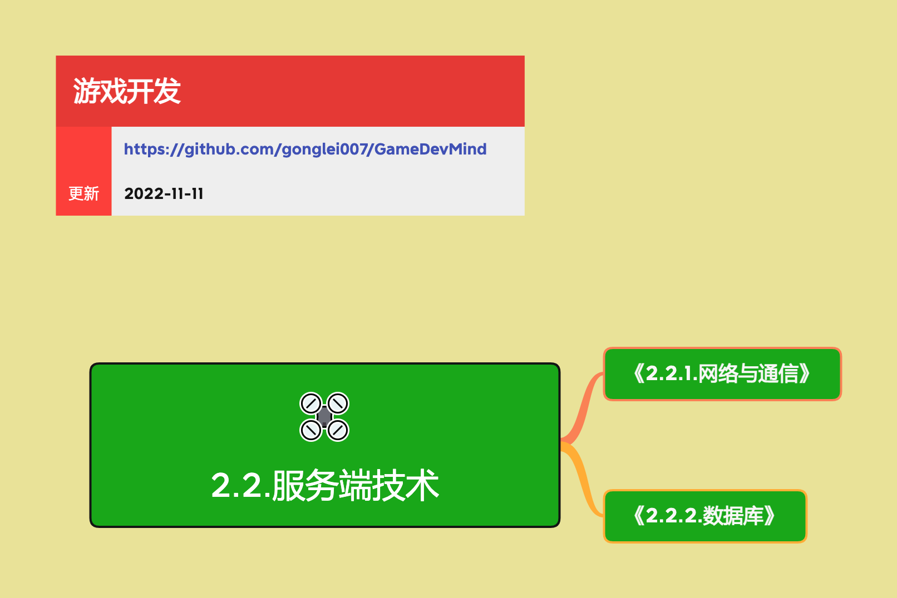

## 服务端技术

对于服务端开发，很少需要考虑产品表现、人机交互或者数字内容相关的事情。服务端的大部分工作都是解决数据、传输和逻辑上的事情。

**关键词:** 
*游戏服务器*

**标签:** 
*等级: 中级, 阶段: 学习|开发, 分类: 技术能力, 角色: 服务端开发*

[返回上一级](2.技术能力.md)

## 按任务找入口

| 我想解决的问题 | 先看 |
|---|---|
| 选择长连接、短连接及传输协议 | [网络与通信](2.2.1.网络与通信.md) |
| 比较事务、索引和数据读写方案 | [数据库](2.2.2.数据库.md) |
| 判断何时引入缓存、队列等中间件 | [服务端中间件](2.2.3.服务端中间件.md) |

## 目录

<!-- BEGIN GENERATED:section-index -->
- [网络与通信](2.2.1.网络与通信.md)
- [数据库](2.2.2.数据库.md)
- [服务端中间件](2.2.3.服务端中间件.md)
<!-- END GENERATED:section-index -->

## 图谱

展开服务端技术图谱

