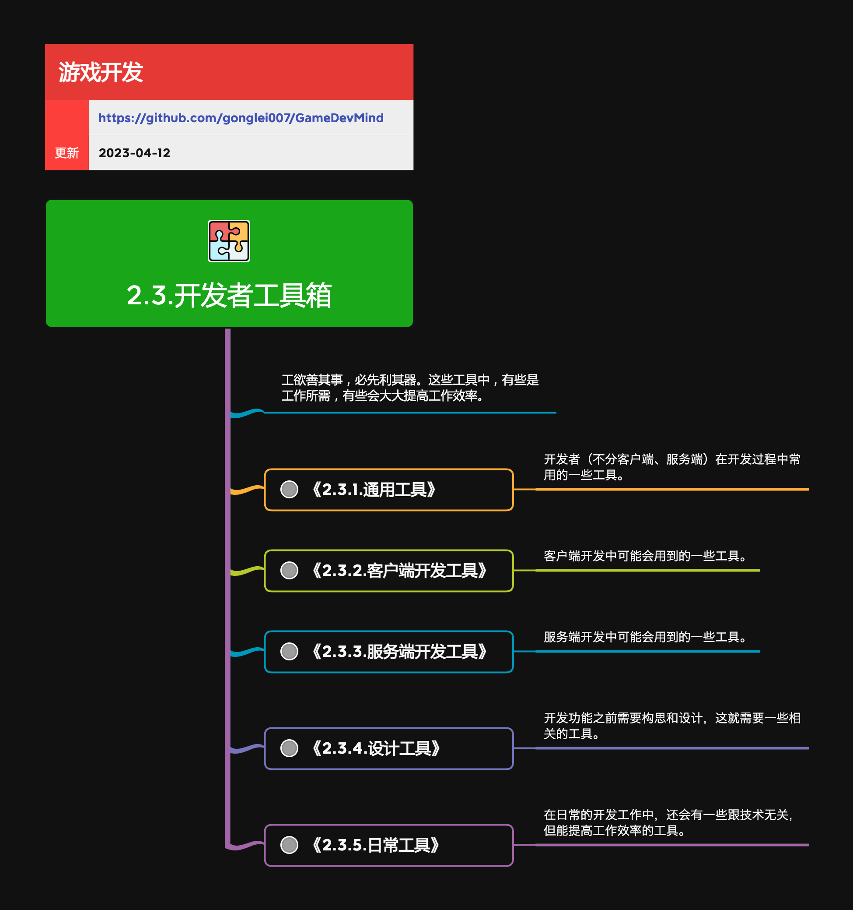

## 开发者工具箱

游戏开发者用于编码、调试、分析和定位技术问题的工具集合。本模块关注工具的使用与选型；定制编辑器、自动化工具和生产线的建设归入生产能力。

**关键词:** 
*开发工具*

**标签:** 
*等级: 入门|初级, 阶段: 学习|开发, 分类: 技术能力, 角色: 客户端开发|服务端开发|全栈开发*

[返回上一级](2.技术能力.md)

## 按任务找入口

| 我想解决的问题 | 先看 |
|---|---|
| 选日常协作和通用工程工具 | [通用工具](2.3.1.通用工具.md) |
| 调试客户端表现或分析性能 | [客户端开发工具](2.3.2.客户端开发工具.md) |
| 抓取与分析服务端调试信息 | [服务端开发工具](2.3.3.服务端开发工具.md) |

## 目录

<!-- BEGIN GENERATED:section-index -->
- [通用工具](2.3.1.通用工具.md)
- [客户端开发工具](2.3.2.客户端开发工具.md)
- [服务端开发工具](2.3.3.服务端开发工具.md)
- [设计工具](2.3.4.设计工具.md)
- [日常工具](2.3.5.日常工具.md)
<!-- END GENERATED:section-index -->

> **边界：** “使用工具解决技术问题”属于技术能力；“开发工具、串联资产流程、实现批量自动化”属于 [4.2.工具开发](../4.生产能力/4.2.工具开发.md)。

## 图谱

展开开发者工具箱图谱

