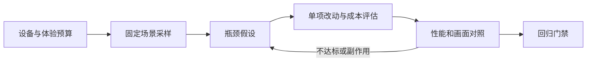

## 客户端优化

客户端优化是在指定设备、画质与玩法负载下，让帧时间、内存、加载、下载量和能耗满足产品预算。先证明瓶颈，再改变实现；降低 Draw Call 或分配次数只是手段，不能单独证明玩家体验改善。

**关键词:** 
*客户端优化,性能优化,帧时间,性能预算,Profiler,CPU优化,GPU优化,Draw Call,SRP Batcher,GPU Instancing,LOD,遮挡剔除,Canvas,内存优化,对象池,加载优化,包体优化,耗电优化,网络优化,对照实验,性能回归,AI Coding*

**标签:** 
*等级: 中级|高级, 阶段: 优化, 分类: 研发能力, 角色: 客户端开发*

**适用范围：** 客户端性能诊断、资源规格评审与发布前验收；渲染和 UI 示例以 Unity 2022.3、URP 与 uGUI 为背景。其他引擎可沿用测量流程，不能照搬 Unity API 或合批规则。

**最近复核：** 2026-10-16。预算和测试时长是待项目确认的设计起点；配套案例没有提交原始产品抓帧，不能作为真机提速证明。

## 目录

- [图谱](#图谱)
- [适用条件](#适用条件)
- [优化策略与诊断](#优化策略与诊断)
- [方案取舍](#方案取舍)
- [不适用场景](#不适用场景)
- [网络、加载与包体](#网络加载与包体)
- [能耗与内存](#能耗与内存)
- [验证方法](#验证方法)
- [AI Coding 指南](#ai-coding-指南)
- [延伸实践](#延伸实践)
- [更多资料](#更多资料)

## 图谱

> 配套：[Draw Call 诊断案例](../../cases/drawcall-optimization.md) · [AI 建议纠错记录](../../ai-cases/unity-drawcall-optimization.md)。AI 协作原则见 [阅读说明](../阅读说明.md#ai-coding-总览)。

## 适用条件

| 开始前应具备 | 要明确的问题 | 缺失时先做什么 |
|------|------|------|
| 设备与质量分档 | 最低机型、系统、图形 API、分辨率、画质、帧率、刷新率与限帧策略 | 建立设备矩阵，不能用编辑器 FPS 代替真机结果 |
| 可重放负载 | 路线、镜头、战斗人数、UI、特效、资源版本与随机种子 | 固定回放或操作脚本，区分启动、稳态与切场景 |
| 可以比较的基线 | 构建提交、引擎/包版本、构建配置、原始记录与采样区间 | 先保存当前构建和记录，再改动 |
| 性能预算 | 帧时间、超预算帧比例、内存峰值、首次可操作时间、持续运行温升 | 程序、美术、策划、QA 共同确定通过条件 |
| 有权限验证取舍 | 是否允许调整阴影、视距、分辨率、加载速度或离线可用性 | 给出画面对照和回滚开关，评审后确定质量档 |

例如，60 FPS 对应约 16.67 ms 的呈现间隔，30 FPS 对应约 33.33 ms。CPU 与 GPU 可流水执行，不能把两个耗时直接相加当总帧时间；还需给抖动留余量。帧率目标取决于玩法与平台，没有“20 多 FPS 普遍足够”的下限。

## 优化策略与诊断

### 优化概览

1. 固定设备、画质、限帧、场景及构建配置，分别记录冷启动、缓存命中和热稳态。
2. 定位超预算帧：主线程工作、渲染提交、GPU 工作、同步等待、GC、资源激活或 IO 各占多少。
3. 写出可以被证伪的假设，例如“渲染提交占主要 CPU 时间；减少状态切换应缩短该段耗时”。
4. 每次只改变一个因素，记录节省的毫秒与新增的内存、加载成本、视觉差异。
5. 单项通过后再组合验证，把实际设备结果纳入发布门禁。

### 性能优化

| 现象 | 优先核实 | 可以尝试 | 同时检查 |
|------|------|------|------|
| 主线程逻辑耗时高 | 调用栈、工作量、分配与等待，采样本身的开销 | 降低更新频率、改善算法和数据布局，再评估 Job/线程 | 调度与同步成本、线程安全、确定性；不要先替换 sqrt |
| 渲染线程或提交耗时高 | 同一帧的材质/Pass/变体与合批中断原因 | SRP Batcher、实例化、静态批处理或减少可见对象 | 实际路径、内存和裁剪粒度；Draw Call 下降不保证 GPU 更快 |
| GPU 耗时高 | GPU 采样、分辨率敏感度、过绘、阴影与带宽 | 调整像素工作、Shader、LOD、视距、阴影与压缩格式 | 画面、GPU 内存和热稳态；顶点阶段不总比像素阶段适合某项计算 |
| 偶发长帧 | 资源激活、同步加载、Shader 首次使用、GC、系统干扰 | 分帧、预热、缓存、减少热路径分配 | 启动时间、常驻内存、失败恢复及长帧是否被转移到别处 |
| UI 更新耗时高 | Layout、Graphic rebuild、Canvas.BuildBatch 与脏标记来源 | 数据变化时更新、拆分动静 Canvas、减少复杂布局 | Canvas 增加可能提高批次数；用 UI Profiler 和 CPU Timeline 验证 |

`Gfx.WaitForPresentOnGfxThread` 表示等待，可能涉及 GPU 工作或垂直同步；单看其占比不能判定 GPU 算力瓶颈。结合渲染线程、GPU 时间线与帧率限制定位。[Unity 常用 Profiler 标记](https://docs.unity3d.com/2022.3/Documentation/Manual/profiler-markers.html)

### 优化工具

| 工具/记录 | 能回答什么 | 不能据此直接断言什么 |
|------|------|------|
| Unity Profiler CPU Timeline / GPU 模块 | 哪些线程、阶段与同步点占时间 | 某等待标记高就该优化 GPU；不支持 GPU 采样时不能填零 |
| Frame Debugger | 当前帧的绘制事件、Pass、材质与合批路径 | 单个事件的真机耗时、Canvas CPU 重建次数或整段路线收益 |
| Memory Profiler / 平台内存工具 | 引用链、原生/托管内存、图形资源与进程内存趋势 | GC.Alloc 为零就没有泄漏或原生内存峰值 |
| 设备平台性能与能耗工具 | 调度、IO、热状态、功率或能量记录 | 短时 CPU/GPU 利用率就等同耗电量 |
| 发布构建回放与业务埋点 | 帧间隔、加载里程碑、异常率与分档回归 | 不同机型、画质或采样窗口的结果可混合比较 |

Development Build 用于归因，Profiler/Deep Profile 会引入开销；最终预算用接近发布配置的构建复测。无法采集的指标写明原因，保留原始记录与工具版本。

## 方案取舍

| 方案 | 适用条件与收益方向 | 代价与限制 | 验证重点 |
|------|------|------|------|
| SRP Batcher | URP/HDRP 中兼容 Shader、同变体的多材质对象，减少 CPU 状态准备 | 不等于把所有绘制合为一个 Draw Call；MPB 会使该 Renderer 退出此路径 | Frame Debugger 路径与 CPU 提交耗时 |
| GPU Instancing | 大量重复 Mesh、相同 Material，Shader 和实例属性支持 | Unity 2022.3 自动路径中 SRP Batcher 优先；MPB 不能自动让任意属性变为实例属性 | instanced 事件、阴影/附加 Pass、总 CPU/GPU 时间 |
| 静态批处理 / 手动合并 Mesh | 不移动的物体，提交成本确为瓶颈 | 静态批处理增加几何内存；手动大 Mesh 合并会改变裁剪粒度 | 内存、构建/加载、可见性与实际批次；动画/变换约束 |
| LOD / 遮挡剔除 | 远处几何过多；有稳定大遮挡物可裁掉隐藏区域 | LOD 有制作与切换成本；遮挡烘焙数据和运行时查询占内存/CPU，空旷场景可能不划算 | 多 FOV/距离的切换、阴影、遮挡开关 A/B 与峰值内存 |
| 图集 / 材质复用 | 外观和采样规则允许共享 | Shader 与主纹理相同不代表材质等价；图集影响 UV、采样、mipmap 和驻留 | 全部属性/贴图/关键字、队列、各 Pass 画面对照 |
| 缓存 / 对象池 / 预加载 | 重复使用明显，分配或 IO 峰值已证实 | 空间换时间，可能提高常驻/峰值内存；池要限制容量并重置状态 | 命中率、淘汰、重复归还、留存引用与长期内存 |
| 降画质 / 动态分辨率 | GPU 负载或热预算不足，产品允许分档 | 降低清晰度或表现，频繁升降档可能造成波动 | 同路线画面、帧稳定性、输入反馈与热稳态 |

合批条件见 [SRP Batcher](https://docs.unity3d.com/2022.3/Documentation/Manual/SRPBatcher.html)、[GPU Instancing](https://docs.unity3d.com/2022.3/Documentation/Manual/GPUInstancing.html)、[静态批处理](https://docs.unity3d.com/2022.3/Documentation/Manual/static-batching.html)。这些是选型约束，不能当作叠加开启即可提速的开关清单。

## 不适用场景

| 不应直接采用的做法 | 原因 | 改为 |
|------|------|------|
| Draw Call 高就全场合并材质或 Mesh | 可能改变画面、增加内存或使裁剪变差 | 先证明提交瓶颈，再做小范围可回滚试验 |
| 所有 Renderer 都加 MPB 并标 BatchingStatic | 混淆静态批处理、SRP Batcher 与实例化的前提 | 按对象类型与路径独立评估 |
| CanvasGroup.alpha = 0 等于停止 UI 开销 | 脚本/布局仍可能运行，交互也需单独处理 | 依生命周期选择禁用 Canvas、GameObject 或只隐藏外观 |
| 所有对象池化、所有资源常驻 | 可能掩盖泄漏并扩大低端机内存压力 | 只处理已定位的热点，定义容量和释放点 |
| 未定位就并行化、换指令集或近似数学 | 可能受同步、带宽等限制，还会改变数值结果 | 先减少工作量，再验证架构适配和正确性 |
| 用 CDN 解决实时战斗同步卡顿 | 资源分发不改变权威模拟与输入确认机制 | 区分下载、网络抖动与主线程拥塞，参见 [网游网络同步](3.2.2.网游网络同步.md) |
| 引用“22 → 58 FPS”当作复现结论 | 缺原始记录，无法排除构建、画质、路线与温度差异 | 标为未复核，按下述方法重新采样 |

## 网络、加载与包体

### 网络优化

把实时消息、资源下载、登录/API 请求分开测量：记录包字节数、频率、排队、编码/解码 CPU 时间、超时和重试。Protobuf 是序列化格式，gzip 是压缩机制，两者不是互斥方案；比较同一消息的 JSON、Protobuf 及各自加压缩版本，包含小包头部、CPU、内存和协议兼容成本，不承诺固定排名。[Protocol Buffers 概览](https://protobuf.dev/overview/)

实时消息可考虑增量、兴趣管理与合适频率，但不能遗漏关键事件。网络线程可以减少主线程阻塞，不会消除往返延迟；还需限制队列，处理断线、幂等和取消，不能在工作线程直接调用不支持多线程的引擎对象 API。

### 加载优化

分别记录读盘/下载、解压、反序列化、依赖解析、GPU 上传和对象激活。二进制序列化不保证“载入即可直接用”，异步请求也不保证所有工作离开主线程。按关键路径优先，给上传与激活设置每帧预算，并测首次可操作时间。

预加载可能缩短切场景等待，却增加启动时间和内存；流式加载需要限流、取消、重试和过期结果处理。验证低速存储、缓存未命中、离线、空间不足、重复进出关卡与中途取消。进度条不能用请求数量冒充实际剩余时间。

### 包体优化

区分构建产物、用户实际下载量、安装占用和运行时内存。Android App Bundle 是发布格式，由 Google Play 生成适配设备的 APK，不等于全部商店都支持同一分发策略。[Android App Bundles](https://developer.android.com/guide/app-bundle)

根据构建报告清理重复依赖与不可达资源，再评估纹理、音频、模型与代码裁剪。压缩影响画质、解压耗时和内存，Shader/代码裁剪要验证反射与动态加载。延迟下载需有版本校验、失败恢复和首玩内容；不能只减首包却遗漏完整流程的下载成本。

## 能耗与内存

### 耗电优化

在满足帧率与响应的前提下减少无用工作，调整后台/菜单限帧和资源更新频率。分别检查 CPU、GPU、屏幕、网络与 IO，不能假定 CPU 总是最大耗电源。动态质量策略要有上下限与滞回，避免反复升降档。

固定亮度、刷新率、音量、网络、环境和起始电量/热状态，记录持续路线的能量、温度/热状态与帧时间，充电状态会干扰比较。利用率只是归因线索，耗电预算应采用平台能耗记录或受控的外部测量。

### 内存优化

预算覆盖托管堆、原生对象、纹理/缓冲区、音频、资源缓存和加载临时副本。压缩包大小不是运行时内存；引擎分类与平台进程口径不能直接相加。对比稳态、切场景峰值和多轮返回后的趋势与引用链。

对象池只针对复用热点，定义容量、所有权、重置、淘汰和释放；引用计数不能自动消除循环引用。持续增长时检查事件订阅、静态集合、原生资源与异步回调，不应直接用更大的池或强制 GC 掩盖。循环所有权反例见 [公会循环引用案例](../../cases/memory-leak-slg.md)。

## 验证方法

### 对照与采样

1. 保存基线/候选提交、构建哈希、Unity/URP 版本、设备/系统/API、分辨率、画质、限帧与采样设置。两版本采用一致工具开销。
2. 固定路线、镜头、输入与随机种子，区分冷启动与暖缓存。建议先做至少三轮交替 A/B，再由实际波动决定样本量；这不是统计显著性的保证。
3. 一次只改一项，证明目标阶段变化，再组合测全程。保留原始 Profiler、平台记录、画面与操作步骤，避免只保存“最好的一帧”。
4. 真机发布配置复测；持续运行至热状态与帧时间趋稳。记录环境、起始温度与充电状态，不能以固定五分钟宣称所有设备都已热稳态。

### 验收矩阵

以下是测试计划，不是本仓库的产品实测报告。各项目先填写预算与允许回退量；缺少目标设备数据时状态为“待验证”。

| 场景 | 应记录的指标与单位 | 通过条件 |
|------|------|------|
| 最低机型战斗、特效密集镜头 | 呈现帧间隔 p50/p95/p99（ms）、超预算帧比例、有效 CPU/GPU 时间（ms） | 帧预算达标，没有用画质或限帧变化暗中改善结果 |
| 重复物体与遮挡路线 | 绘制/SetPass 数、提交/GPU 时间、几何内存、画面 | 路径正确且瓶颈减轻；材质、阴影、LOD、裁剪无回归 |
| 血条/背包频繁变化 | Layout/Graphic rebuild、Canvas.BuildBatch 时间与调用、交互与显隐 | 不把每次 setter 等同独立 rebuild；UI 正确且 CPU 达标 |
| 冷启动、切场景、取消 | 首次可操作时间、阶段耗时（ms）、峰值内存（MiB）、错误率 | 不遗漏依赖/上传/激活，弱网、取消与重试可恢复 |
| 多轮进出关卡、池压力 | 进程/分类内存、GC.Alloc（B/frame）、池容量和留存引用 | 无无法解释的持续增长；峰值达标，资源可释放 |
| 持续运行、前后台切换 | 帧稳定性、能量（J 或平台口径）、热状态、后台唤醒 | 热稳态仍达标，输入/恢复正常，能耗口径一致 |
| 安装、延迟下载 | 下载量、安装占用（MiB）、资源可用性与失败恢复 | 以设备实际下载为准，资源/反射/Shader 裁剪不破坏玩法 |

分位数基于明确的采样窗口，不能平均 FPS 再倒数冒充 p95，也不能把 Present 等待当有效 GPU 工作。GPU 采样不可用时，保留平台分析结果或标为缺失。

### 仓库内可执行检查

[render_audit](../../code/gamedevmind/3.研发能力/3.1.3.客户端优化/render_audit/) 提供只读 Unity Editor 审计：统计材质对象引用，列出同 Mesh/同 Material 的单子网格候选，保守排除 MPB、无效槽位与未激活对象。它不会合并材质、标 Static 或修改 MPB；候选不能代替 Frame Debugger 判定实际合批。

示例包含无需 Unity 的 .NET 回归和 Unity Editor 集成回归，命令与边界见其 README。CI 执行 .NET 回归、内部链接、文档/图片与生成内容检查；Unity 编译、场景不被改写的验证和真机性能分别记录，不能用文档门禁通过替代真机验收。

## AI Coding 指南

| 阶段 | 提供给 AI | 要求的交付与审查 |
|------|------|------|
| 定位 | 引擎/管线、设备、原始标记与线程、帧限制、复现步骤 | 区分事实、假设与缺失记录，不凭 Wait 占比下结论 |
| 选型 | 阶段预算、对象生命周期、画质和内存约束 | 比较至少两种方案及不适用条件，注明成本估算并非实测 |
| 实现 | 最小项目或只读快照、允许修改范围 | 先审计；批量改资源需明确映射、Undo、持久化与回滚 |
| 验证 | A/B 计划、边界输入与原始记录 | 给出可运行回归与真机验收步骤，不生成虚构提升表 |

提示词示例：“Unity 2022.3 + URP，固定分辨率与帧限制，目标机 CPU Timeline 显示渲染提交超预算。请列出还需哪些记录，比较 SRP Batcher 与重复 Mesh 的实例化路线；生成只读审计，不自动换材质，给出画面、内存与耗时对照方法。”

## 延伸实践

| 类型 | 内容与边界 |
|------|------|
| 诊断案例 | [Draw Call 优化：证据与取舍](../../cases/drawcall-optimization.md)，历史说法纠错与复测表 |
| AI 对话复核 | [用 Cursor 优化 Draw Call](../../ai-cases/unity-drawcall-optimization.md)，保留旧输出并说明拒绝原因 |
| 可运行代码 | [只读渲染审计](../../code/gamedevmind/3.研发能力/3.1.3.客户端优化/render_audit/)，验证引用身份与不改场景，不承诺提速 |
| 相关知识 | [客户端3D场景开发](3.1.2.客户端3D场景开发.md)、[UI 系统](3.1.6.UI系统.md)、[网游网络同步](3.2.2.网游网络同步.md) |

## 更多资料

| 原始资料 | 复核用途 |
|------|------|
| [Unity Profiler 标记（2022.3）](https://docs.unity3d.com/2022.3/Documentation/Manual/profiler-markers.html) | 工作、等待与垂直同步 |
| [SRP Batcher](https://docs.unity3d.com/2022.3/Documentation/Manual/SRPBatcher.html) / [GPU Instancing](https://docs.unity3d.com/2022.3/Documentation/Manual/GPUInstancing.html) | 管线、MPB 与路径优先级 |
| [静态批处理](https://docs.unity3d.com/2022.3/Documentation/Manual/static-batching.html) / [LOD Group](https://docs.unity3d.com/2022.3/Documentation/Manual/class-LODGroup.html) / [遮挡剔除](https://docs.unity3d.com/2022.3/Documentation/Manual/OcclusionCulling.html) | 约束、裁剪和成本 |
| [Unity UI 优化建议](https://unity.com/how-to/unity-ui-optimization-tips) | Canvas 隔离与显隐取舍 |
| [uGUI Image 源码](https://github.com/Unity-Technologies/uGUI/blob/main/com.unity.ugui/Runtime/UGUI/UI/Core/Image.cs) | fillAmount 改变时调用 SetVerticesDirty；结合项目安装包版本复核 |
| [Protocol Buffers](https://protobuf.dev/overview/) / [Android App Bundle](https://developer.android.com/guide/app-bundle) | 序列化和平台分发范围 |
