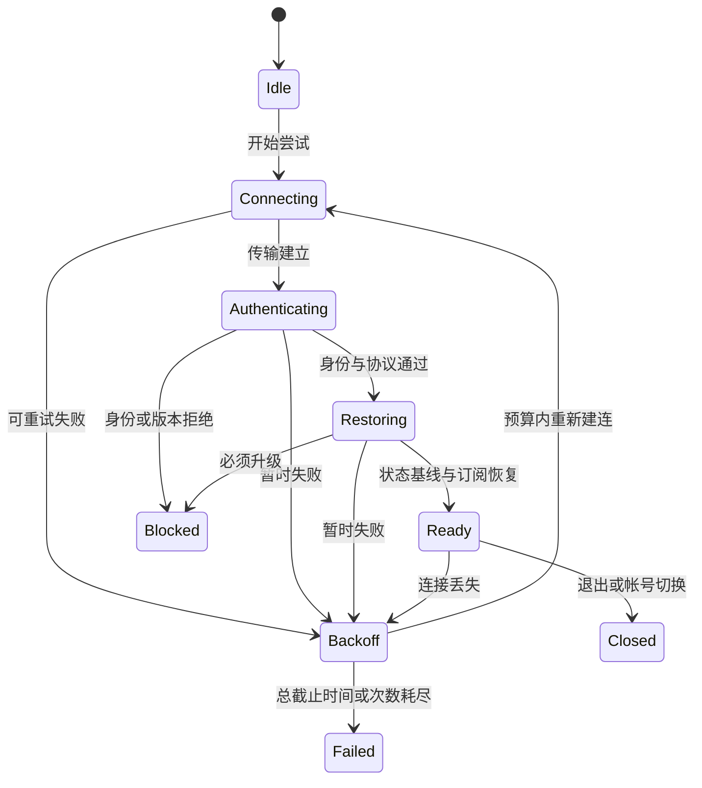

## 客户端网络系统

客户端网络系统负责把连接、认证、请求、恢复和界面反馈组织成可控生命周期。目标是让每次操作都有可解释的结果，让旧连接、旧场景和过期请求不能修改当前状态，并在断网或过载时保持资源有界。

**关键词:** 
*客户端网络系统,重连,压缩,并发,DNS,HTTP,Socket,WebSocket,超时,多线程,域名解析,HTTP DNS,IPv6,多连接通道,消息压缩,Protobuf,GZip,状态管理,事件接口,桥接接口,异常处理,连接失败,连接断开,定时重试,Buffer,缓冲区,Best HTTP,请求关联,会话代次,取消,幂等,背压,AI Coding*

**标签:** 
*等级: 中级|高级, 阶段: 开发, 分类: 研发能力, 角色: 客户端开发*

**适用范围：** 游戏客户端的连接编排、请求生命周期、主线程交付、重试和恢复。协议分帧/可靠性见 [网络与通信](../2.技术能力/2.2.1.网络与通信.md)，预测/校正、插值和 AOI 见 [网游网络同步](3.2.2.网游网络同步.md)。引擎/库 API 须按项目版本、目标平台与构建后端核对。

**最近复核：** 2026-10-17。配套生命周期模型与延迟同步模型为 Python 3.11+ 标准库教学，不是 Unity/C# 运行库。通过本地模型和 CI 不代表 DNS、TLS、移动切网、平台浏览器、引擎线程或生产容量已经验收。

## 目录

- [适用条件](#适用条件)
- [方案取舍](#方案取舍)
- [不适用场景](#不适用场景)
- [目标与协议](#目标与协议)
- [连接与消息](#连接与消息)
- [生命周期与接口](#生命周期与接口)
- [并发与传输](#并发与传输)
- [中间件](#中间件)
- [验证方法](#验证方法)
- [AI Coding 指南](#ai-coding-指南)
- [延伸实践](#延伸实践)
- [更多资料](#更多资料)

## 适用条件

| 先明确什么 | 需要形成的约束 | 缺失时先做什么 |
|------|------|------|
| 平台和生命周期 | 引擎/SDK/传输库版本、原生或浏览器、前后台、场景退出、帐号切换 | 列出允许的 API、回调线程、后台限制与关闭责任 |
| 业务结果 | 只读查询、可替换状态、聊天、交易等消息分别定义成功、失败与未知结果 | 明确哪些操作允许重试，哪些必须同请求身份查询/恢复 |
| 网络和入口 | 域名、IPv4/IPv6、代理、证书、目标地区 RTT/抖动、切网模式 | 分阶段采样 DNS/连接/TLS/认证/恢复与端到端耗时 |
| 并发和资源 | 请求数、在途字节、事件队列、每帧交付、下载与实时流预算 | 先写上限和拒绝/合并/降级规则，不能用无限 Buffer 兜底 |
| 恢复契约 | 会话代次、凭证生命周期、协议兼容、状态基线、订阅与输入序号 | 与服务端约定恢复成功条件；连接建立不能直接标为可玩 |

## 方案取舍

| 方案 | 适用条件 | 代价与限制 | 验证重点 |
|------|------|------|------|
| HTTPS 请求/响应适配器 | 登录、配置、查询、可关联业务命令 | 连接可复用；超时/取消不证明服务端未执行；下载要独立预算 | 身份、证书、请求关联、幂等与取消清理 |
| 持续双向通道 | 实时推送、聊天或对战 | 保活、重连、消息积压和恢复更复杂；库的“已连接”含义有限 | 认证/恢复门禁、旧事件隔离、慢消费者与代理空闲 |
| 多连接/多通道 | 聊天、下载、对战有明确隔离需求 | 更多握手、耗电、带宽竞争与管理成本；逻辑队列不等于传输隔离 | 独立状态和预算、故障影响范围、公平调度 |
| 异步 IO + 单拥有者状态 | API 支持异步，可把结果送回客户端主循环 | 回调仍可能重入，解码/派发也会占主线程 | 状态只由拥有者修改，每帧交付有界 |
| 工作线程 + 有界邮箱 | 目标平台支持线程，阻塞 IO/重解码确需隔离 | 线程取消、消息所有权与关闭更复杂，不能直接操作 Unity 对象 | 不可变结果、容量/字节上限、退出和旧代次处理 |
| 全局顺序队列 | 真正存在全局前后依赖，流量很小 | 一个慢请求阻塞全部业务，可能拖垮心跳/聊天 | 排队时长、取消、超时；优先按业务实体缩小串行范围 |
| 业务键串行 / 查询最新结果生效 | 同一背包/订单有依赖，或搜索/列表只需最新视图 | 需要服务端版本和幂等；“只看最新”只适合可替换查询展示 | 乱序、重复、场景切换、并发写与权威版本 |

## 不适用场景

| 不应直接采用 | 原因 | 改为 |
|------|------|------|
| “HTTP 是短连接，实时游戏只选 Socket” | HTTP 语义与物理连接寿命不同，浏览器/平台也有限制 | 按消息契约选择传输和连接复用策略 |
| “HTTP DNS 能防住所有劫持” | 解析通道、缓存、回退和服务身份仍可能受攻击 | 认证解析结果/传输、校验证书和域名身份，测双栈及回退 |
| “Protobuf 和 GZip 二选一” | 前者是序列化格式，后者是压缩格式 | 分别测 schema 编解码、压缩收益与解压上限 |
| “连接成功就解除全部等待并进入游戏” | 认证、协议协商、订阅和状态基线可能未恢复 | 恢复完成才进入 Ready，分别报告连接与可玩耗时 |
| “遮罩防连点即可防重复交易” | 多端、重试、响应丢失仍可能重复执行 | UI 防误操作 + 服务端同业务身份幂等/结果查询 |
| “取消或超时就判失败，再发新订单” | 请求可能已提交，只是结果尚未交付 | 标记结果未知，保留业务 ID，查权威结果或安全重试 |
| “只要返回同消息类型就调用最早回调” | 同类型并发、乱序或旧连接回包会串请求 | 会话代次 + 单调请求 ID + 操作/实体版本关联 |
| “所有平台都放一个网络线程” | 浏览器和运行时支持不同，异步 IO 也未必需要专用线程 | 按目标库/平台验证线程与回调规则 |
| “无限重连、无限排队能提高成功率” | 故障被放大、内存和等待失控，旧操作也可能过期 | 总截止时间、抖动退避、次数/容量上限和明确出口 |

## 目标与协议

### 系统概览

### 目标

记录“连接可用率、恢复可玩时间、请求完成/未知/拒绝率、队列年龄、每帧分发耗时、内存和耗电”，明确采样窗口和平台。不只优化 Socket 连接成功率，也不能用平均 RTT 解释所有业务等待。

### 协议

把业务协议、传输适配器与 UI 解耦。HTTPS 可复用连接，GET/POST 是方法，下载是用例；Socket 是接口抽象，不与 HTTP/WebSocket 处于同一分类层。Socket.IO 有自己的协议，不等于普通 WebSocket。具体保证与选型见 [网络与通信](../2.技术能力/2.2.1.网络与通信.md)。

业务请求包含受控操作、版本、请求身份及必要数据；客户端传来的 uid/时间戳不能作为可信授权或防重放证明。凭证在受保护通道内传输并避免进入日志，客户端不保存服务端密钥。

### 域名解析

默认使用平台维护的解析与安全传输能力。双栈连接可按成熟库的 Happy Eyeballs 策略交错尝试候选，避免逐 IP 等满超时后才尝试下一项；每次尝试共享总截止时间，成功后取消其他尝试并关闭多余连接。[RFC 8305](https://www.rfc-editor.org/rfc/rfc8305.html)

自定义 HTTP DNS/DoH 必须说明提供方、认证、TTL/负缓存、隐私和失败回退。缓存不永久锁定某 IP，切网后按策略重评估；回退也不得关闭证书校验。直连解析出的 IP 时要保留原服务域名的 TLS 身份校验/SNI 及适当的 HTTP Host，不能将任意 IP 当作受信服务器。[TLS 服务身份 RFC 9525](https://www.rfc-editor.org/rfc/rfc9525.html)

Apple 的 IPv6-only 支持要求应结合目标发布平台检查；支持 IPv6 不只是能解析 AAAA。用 DNS64/NAT64 环境和真实目标构建验证，避免硬编码 IPv4 和地址族假设。[Apple IPv6-only 指南](https://developer.apple.com/support/ipv6/)

## 连接与消息

### 多连接通道

为每个通道定义拥有者、认证身份、连接代次、消息序号、请求表和资源预算。聊天失败是否影响对战须由业务决定；全局网络管理器可以聚合状态，不能把“某条连接恢复”广播成“所有业务恢复”。

重用通道对象前清理计时器、订阅、排队字节和回调，旧完成事件必须携带原代次。每次帐号切换还需要新的帐号生命周期；旧适配器只能投递给其原管理器实例，不能因新实例序号从头计数而路由错对象。

### 消息

区分线上的请求 ID、用于交易去重的业务 ID、连接代次和服务器数据版本。请求 ID 在客户端管理器实例内单调且不复用；业务 ID 在提交结果不确定、重连或查询恢复时保留。连接代次只隔离回调，不提供服务端幂等。

客户端和服务端校验类型、大小、协议版本、授权与业务范围；序列化、压缩、加密分别设置输入/输出预算。不要凭字段字节猜类型，也不要让任意大包或解压结果直接进入主线程。[Protobuf 格式说明](https://protobuf.dev/overview/)

## 生命周期与接口

### 状态管理

“连接成功”“认证成功”“可玩”是不同阶段，各阶段有超时，同时受一次恢复活动的总预算约束。重连每次增加代次，重新认证/校验兼容并获取可信状态基线，然后恢复订阅和业务结果；不能从 Reconnecting 直接跳到 Connected 就算恢复。

心跳和超时用单调时钟。前后台暂停时不要按积累的帧计数连续触发重试；回前台检查已过时间和会话有效性，按需重新认证与同步。关闭必须使后续旧回调失效，并解除适配器订阅/取消后台任务。

### 事件接口

工作线程只提交拥有明确所有权的不可变事件；状态修改、业务完成与 UI 通知由指定主循环拥有者执行。每次交付先检查管理器实例、代次和请求身份，场景 UI 另检查订阅生命周期；不能只靠 try/catch 访问已销毁对象。

一次请求只释放一次等待/遮罩令牌：响应、超时、取消和关闭相互竞争时只允许一个终态交付。对已经交给传输的请求，超时/取消是本地停止等待，业务结果可能未知；迟到回包不能再次触发旧 UI。已提交的结果应通过业务 ID 查询/恢复，而不是丢弃后重新创建效果。

### 桥接接口

提供状态、请求结果、恢复/升级建议和诊断事件，让业务/UI 决定页面与文案。不要由底层每个超时直接弹窗，避免重复弹窗和重试风暴。等待令牌按请求/场景计数，结束某个请求不能隐藏其他请求仍需的遮罩。

### 异常处理

| 类别 | 自动处理方向 | 用户或业务出口 |
|------|------|------|
| 暂时性解析/连接/传输失败 | 在总预算内按抖动退避重连，刷新合适缓存 | 预算耗尽后给明确重试/退出入口 |
| 身份失效/帐号变更 | 停止当前受保护操作和旧事件交付 | 重新登录或切换帐号，避免无限重试凭证 |
| 协议不兼容/必须升级 | 停止当前连接活动和自动重试 | 按可信策略进入升级流程，不能永远显示“重连中” |
| 业务拒绝/版本冲突 | 保留结构化结果，由业务决定刷新或补偿 | 不应归类为网络异常后自动重做 |
| 发送后超时/取消/断线 | 标记结果未知，保留业务身份 | 查询权威结果，按业务幂等契约恢复 |
| 队列满/主循环交付不过来 | 拒绝准入、可替换数据合并或中止通道 | 上报过载，不能静默丢关键控制/交易结果 |

退避应有抖动、最大间隔、尝试上限和总截止时间；固定斐波那契间隔不足以避免同时重连。重试只由约定一层负责，底层连接重试不等于业务请求重发。安全重试还需尊重服务端限流与业务有效期。

## 并发与传输

### 多线程

Unity API 的线程和异步行为须按引擎/传输库版本核对，不能用 Python 模型代替实际 Unity 构建和退出测试。许多 Unity API 只能在主线程使用；阻塞 IO 和大量解码若移到后台，要用安全交付机制回主线程，控制每帧处理时间。[Unity 线程与异步说明](https://docs.unity3d.com/6000.0/Documentation/Manual/async-awaitable-continuations.html)

取消应传播到能取消的阶段并释放资源，但调用 UnityWebRequest.Abort 之类接口不等于撤销服务端效果。关闭网络管理器时先停止新操作，再解除订阅/关闭通道，完成在途请求的本地终态；锁不能跨外部回调或网络等待。[UnityWebRequest.Abort](https://docs.unity3d.com/ScriptReference/Networking.UnityWebRequest.Abort.html)

### 并发

响应按请求 ID 关联，可以后发先至；同一实体的写依赖用业务串行、服务器版本/CAS 或事务约束解决。传输保序不能保证并行业务处理的完成顺序。搜索/列表可按查询版本只显示最新结果，交易/发奖结果不可按“只显示最新”随意丢弃。

UI 防连点只是交互优化；服务端必须独立验证授权、余额、幂等与版本。跨端提交和响应丢失仍可能绕过客户端遮罩，参见 [数据库](../2.技术能力/2.2.2.数据库.md)。

### 传输

分别设 DNS、连接、TLS、认证、恢复、排队、首字节/空闲与总截止时间。总时间从操作准入开始计，取消/重试不能重置为新的完整预算。原稿的消息 3s/1.2s、下载 15s/5s 不能作为通用推荐，应按目标网络、业务有效期和用户体验实测。

Buffer 大小不决定最低可用下载速率；消息可以分段填充/消费，判断超时不应要求“必须在期限内填满整个 Buffer”。持续下载要分离总截止时间与无进展超时，支持目标平台允许的流式落盘、校验和断点恢复，限制驻留内存。

限制每消息、每连接、全局与在途请求/结果/事件队列资源。请求准入可为最终结果预留容量，避免队列满后连取消/错误都无法交付；单帧交付同时限制数量和耗时。底层分帧、部分发送与写队列见 [协议示例](../../code/artile-sample-code/02-technical/05-networking/)。

## 中间件

优先评估项目已有维护中的传输库，用薄适配层统一请求身份、时钟、代次、关闭与错误语义。功能多不代表集成成本低，更不代表已解决业务恢复和幂等。

| 需要核对 | 具体证据 |
|------|------|
| 平台与版本 | 引擎版本、IL2CPP/AOT、浏览器限制、移动前后台和证书栈的实际构建 |
| 请求生命周期 | 回调线程、重入、取消后回调、超时范围、内置重试与连接池行为 |
| 资源和安全 | 最大消息/解压、缓冲/队列预算、证书/身份验证、日志脱敏 |
| 维护和接入 | 许可、维护状态、升级成本、可诊断性和故障测试 |

UnityWebRequest、项目使用的 WebSocket/Socket 库或 Best HTTP 等产品只是待评估候选，本文没有完成最新版产品横评或推荐采购。不要复制过时 API，也不要声称本地纯模型已验证中间件兼容性。

## 验证方法

记录提交/构建、引擎/运行时与库版本、目标设备/后端、平台权限、证书/代理、网络脚本、载荷、并发、预算与采样窗口。使用可控时钟和事件调度验证逻辑，再以真实目标构建和服务端验收集成。以下为项目验收计划，未执行项不能记为通过：

| 场景 | 应提交证据 | 通过条件 |
|------|------|------|
| 入口与双栈 | DNS 失败/TTL/回退、IPv4/IPv6、DNS64/NAT64、多候选连接、证书错误 | 总预算有界，保留域名身份，不通过关闭校验“修复” |
| 状态与恢复 | 连接/认证/恢复各阶段失败、旧代次事件、重连/升级/帐号切换 | 只有完整恢复才 Ready；旧结果不串用户/场景；永久拒绝停止重试 |
| 请求竞态 | 同类型并发、乱序/重复响应、截止边界、取消和关闭竞争 | 请求关联正确且本地终态只交付一次；业务未知不当作未提交 |
| 业务恢复 | 已提交但响应丢失、同 ID 重试、异参冲突、跨端写、版本回退 | 无重复效果；权威结果能查询；UI 遮罩不作为一致性保护 |
| 线程与 UI | 后台生产、主循环消费、场景销毁、反复进退与退出 | 无越线程操作/悬挂订阅，交付和关闭有界，无重复弹窗/遮罩泄漏 |
| 超时与背压 | 慢发/慢读、无进展下载、请求/结果/邮箱满、连续恢复失败 | 内存和排队不超预算；重试不延长总截止时间，不静默丢关键消息 |
| 同步与时序 | 输入确认、变 dt、停止/变向、乱序快照、历史窗口耗尽 | 同确认时点校正、最终收敛；插值时间轴正确，旧快照不回退 |
| 真机与容量 | 前后台/切网、弱网/代理、长稳、帧耗时/分配/耗电 | 在目标业务预算内；错误/拒绝/未知结果计入报告 |

### 仓库可执行回归

1. [客户端生命周期模型](../../code/gamedevmind/3.研发能力/3.1.4.客户端网络系统/client_network/)：受控时间、认证/恢复门禁、抖动重试和总预算、代次/请求关联、取消/超时/关闭、后台邮箱与单拥有者交付。Python 标准库，不发送真实请求，不测试 Unity API 或服务端幂等。
2. [延迟同步模型](../../code/artile-sample-code/03-rd/03-sync/)：持续服务器状态、两个玩家的独立双向通道、各向 100ms 延迟、原 dt 输入确认重放、停止/变向、消息全部排空和远端历史插值。各向 100ms 的名义 RTT 是 200ms，另有调度等待；不是实测延迟或带宽报告。
3. [协议与 Socket](../../code/artile-sample-code/02-technical/05-networking/) / [真实回环](../../code/artile-sample-code/01-foundation/06-os-network/)：类型、分帧、部分写入、心跳与本机 TCP/UDP；不证明真实移动网络表现。

前两类回归接入 Windows/Linux 阻断门禁。同步模型中的恢复、钟差和状态重放均有 README 边界；没有 DNS/TLS/引擎集成、物理、AOI 或生产容量验收。已有 [强更案例](../../cases/major-version-force-update.md) 中的资源下载示例也没有实现登录兼容和强更门禁，不能混作相同测试。

## AI Coding 指南

| 阶段 | 提供材料 | 应要求并核对 |
|------|------|------|
| 设计 | 平台、业务结果、恢复状态机、预算与 UI 生命周期 | 区分连接与就绪、传输与业务重试，列不适用场景 |
| 实现 | 代次/请求 ID、业务 ID、取消语义、线程归属与队列上限 | 旧事件隔离、一次完成、主循环交付、关闭清理与过载出口 |
| 验证 | 受控时钟、事件顺序、目标构建、弱网与服务端故障计划 | 输出可运行竞态断言；不把模型通过写成真机网络或 Unity 已验收 |

提示词示例：“客户端由主循环拥有状态，后台只投递有界不可变事件。请实现认证/恢复后才可发请求的状态机，按代次和请求 ID 匹配；测试旧连接、乱序/重复、取消/超时/关闭竞争及重试总预算。已发送操作取消后结果未知，不自动用新业务 ID 重发。”协作原则见 [阅读说明](../阅读说明.md#ai-coding-总览)。

## 延伸实践

| 类型 | 入口与边界 |
|------|------|
| 代码 | [生命周期模型](../../code/gamedevmind/3.研发能力/3.1.4.客户端网络系统/client_network/)、[延迟同步模型](../../code/artile-sample-code/03-rd/03-sync/) |
| 案例 | [强更与登录兼容复核](../../cases/major-version-force-update.md)、[回弹复核](../../cases/network-reconciliation.md) |
| 知识 | [网络与通信](../2.技术能力/2.2.1.网络与通信.md)、[网游网络同步](3.2.2.网游网络同步.md)、[客户端优化](3.1.3.客户端优化.md)、[产品热更新](../6.运营能力/6.2.3.产品热更新.md) |

## 更多资料

| 原始资料 | 复核用途 |
|------|------|
| [Happy Eyeballs RFC 8305](https://www.rfc-editor.org/rfc/rfc8305.html) / [TLS 身份 RFC 9525](https://www.rfc-editor.org/rfc/rfc9525.html) | 双栈候选、服务身份与证书 |
| [Apple IPv6-only](https://developer.apple.com/support/ipv6/) | DNS64/NAT64 与平台测试范围 |
| [Unity 异步支持](https://docs.unity3d.com/6000.0/Documentation/Manual/async-awaitable-continuations.html) / [Abort](https://docs.unity3d.com/ScriptReference/Networking.UnityWebRequest.Abort.html) | 主线程与取消 API；按具体版本核对 |
| [Protobuf 概览](https://protobuf.dev/overview/) | 序列化和压缩的区别 |
