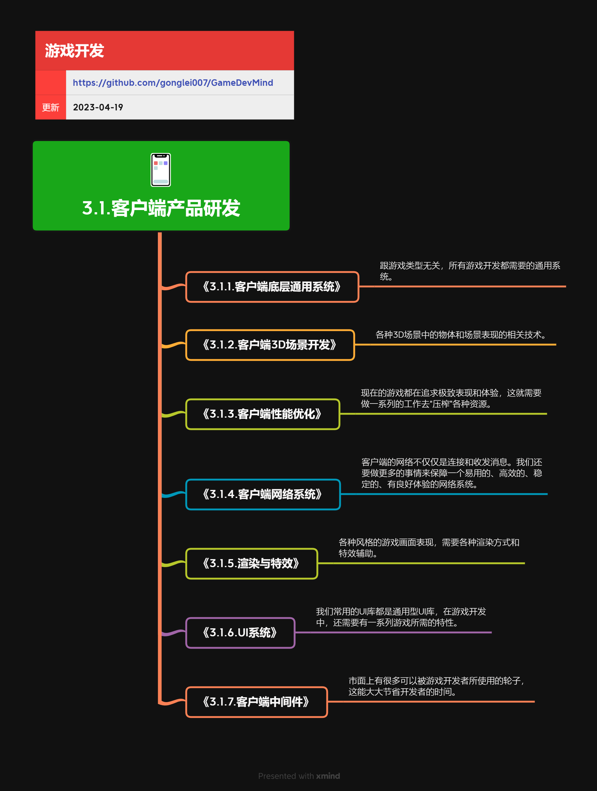

## 客户端产品研发

产品研发中跟客户端业务相关的系统。

**关键词:**  
*客户端,Unity*

**标签:** 
*等级: 中级|高级, 阶段: 开发, 分类: 研发能力, 角色: 客户端开发*

[返回上一级](3.研发能力.md)

## 按任务找入口

| 我想解决的问题 | 先看 |
|---|---|
| 真机掉帧或卡顿，先定位瓶颈并建立复测步骤 | [客户端优化](3.1.3.客户端优化.md) 配套：[开放世界卡顿复核](../../cases/drawcall-optimization.md) |
| 断线重连后旧请求写回状态，核对取消与回调归属 | [客户端网络系统](3.1.4.客户端网络系统.md) 配套：[客户端网络生命周期示例](../../code/gamedevmind/3.研发能力/3.1.4.客户端网络系统/client_network/) |
| 退出场景后对象、缓存或订阅仍然存活 | [客户端底层通用系统](3.1.1.客户端底层通用系统.md) 配套：[GGFramework 实践导读](../../docs/工程实践/GGFramework.md) |
| 返回时窗口关错或界面状态丢失 | [UI系统](3.1.6.UI系统.md) |

## 目录

<!-- BEGIN GENERATED:section-index -->
- [客户端底层通用系统](3.1.1.客户端底层通用系统.md)
- [客户端3D场景开发](3.1.2.客户端3D场景开发.md)
- [客户端优化](3.1.3.客户端优化.md)
- [客户端网络系统](3.1.4.客户端网络系统.md)
- [渲染与特效](3.1.5.渲染与特效.md)
- [UI系统](3.1.6.UI系统.md)
- [客户端中间件](3.1.7.客户端中间件.md)
<!-- END GENERATED:section-index -->

## 更多资料

### 在线资料
* [一些关于Unity和C#编程的教程](https://catlikecoding.com/unity/tutorials/)
* [大佬帮你做游戏之GitHub](https://zhuanlan.zhihu.com/p/591864923) - 分享了GitHub上的一些关于unity的不错的库。

## 图谱

展开客户端产品研发图谱

