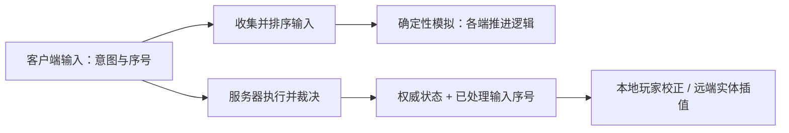
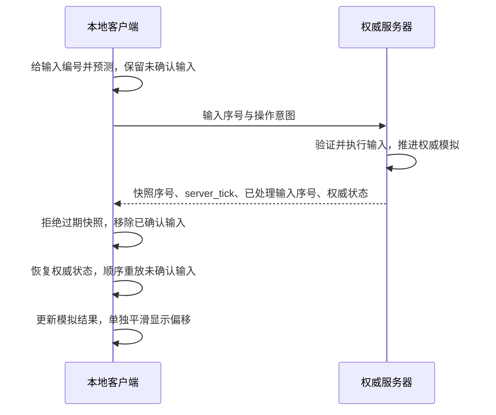

## 网游网络同步
<p>
网游网络同步解决的是：在延迟、丢包和各端计算差异存在时，由谁裁决游戏结果、传输哪些信息，以及客户端如何呈现可交互的世界。本页面向客户端与服务端共同做架构选型、协议评审和原型验收；不能仅按「RTS / FPS / MOBA」标签选择方案。
</p>

**关键词:**<br/>
*AOI,状态同步,帧同步,混合同步,确定性,回滚同步,快照,输入确认,插值,预测,校正,延迟补偿,AI Coding*

**标签:**<br/>
*等级: 高级, 阶段: 开发, 分类: 研发能力, 角色: 服务端开发|客户端开发*

**适用范围：** 实时多人玩法的运行时同步设计。本文中的「状态同步」泛指传递权威状态或状态修正的方案；具体资料还会区分快照插值与两端运行模拟的 state synchronization，不能把这些实现当成完全相同的机制。

**最近复核：** 2026-10-16。原理参考文末原始技术文章与引擎官方文档；示例参数、容量估算和验收预算均为设计起点，不是本仓库已测得的产品指标。

## 目录

- [同步概览](#同步概览)
- [说明](#说明)
- [适用条件](#适用条件)
- [同步方式](#同步方式)
- [方案取舍](#方案取舍)
- [不适用场景](#不适用场景)
- [同步技术](#同步技术)
- [同步内容](#同步内容)
- [AOI（Area of Interest，兴趣区域）](#aoiarea-of-interest兴趣区域)
- [验证方法](#验证方法)
- [AI Coding 指南](#ai-coding-指南)
- [延伸实践](#延伸实践)
- [更多资料](#更多资料)

> AI 协作的通用原则见 [阅读说明 - AI Coding 总览](../阅读说明.md#ai-coding-总览)。

## 同步概览



这张图展示两类常见数据流，不规定服务器只能转发或只能计算。实际项目可以由服务器复算确定性逻辑，也可以对不同系统采用不同的数据分发方式。

## 说明

| 必须分开的概念 | 需要回答的问题 |
|------|------|
| **结果权威** | 谁裁决位置、伤害、掉落和胜负？竞技场景通常需要可信服务器验证；客户端预演不等于有权提交最终结果 |
| **同步模型** | 主要传输入、状态，还是两者结合？确定性模拟是否已经验证？ |
| **网络拓扑** | 独立服务器、玩家主机还是 P2P？它与帧同步 / 状态同步不是一一对应关系 |
| **传输语义** | 哪些消息需可靠交付、排序或幂等，哪些旧数据可丢弃？UDP、TCP 或可靠 UDP 本身不决定同步模型 |
| **时间轴** | 模拟 Tick、快照序号、输入序号与渲染帧分别是什么？它们可能频率不同，也不能直接互作确认号 |

同步目标不是让所有玩家在同一墙钟时刻显示完全相同的画面：本地预测常领先于已收到的服务器状态，远端插值会刻意呈现较早的状态。需要保证的是裁决规则、逻辑时间关系与允许的误差边界。参见 [Epic 网络架构说明](https://dev.epicgames.com/documentation/en-us/unreal-engine/networking-overview-for-unreal-engine)与 [Entity Interpolation](https://www.gabrielgambetta.com/entity-interpolation.html)。

## 适用条件

先填约束，再列候选方案。无法回答的项目应进入原型验证，不能由类型标签替代。

| 约束 | 需要明确的内容 | 对选型的影响 |
|------|------|------|
| **交互与规模** | 同房玩家数、同时活动实体数、每连接可见实体数；有无高频碰撞、命中判定 | 大量单位不等于大量玩家；前者可能节省输入同步带宽，后者会增加输入分发与等待成本 |
| **确定性** | 相同初始状态、输入顺序、随机种子和配置，在目标平台、编译器及构建模式下是否产生相同逻辑结果 | 确定性帧同步 / 输入回滚必须先通过一致性试验；固定 Tick 和相同种子只是必要条件的一部分 |
| **权威与信息边界** | 哪些结果必须在可信服务器验证，哪些隐藏信息绝不能发给对手 | 服务器只转发输入不能自动阻止数值篡改；只在客户端隐藏模型不能防止读取已收到的隐藏状态 |
| **体验与网络** | 可接受的输入等待、表现延迟、校正幅度；目标 RTT、抖动、丢包与断流分布 | 等输入、增加插值缓冲、预测和回滚各自付出不同代价，不能承诺消除真实网络延迟 |
| **恢复与观战** | 中途加入、重连、录像、观战延迟、版本兼容与检查点间隔 | 需要可恢复的完整状态、版本标识和必要的输入记录，不能只考虑正常对局的数据流 |
| **资源与团队** | 服务器 Tick 预算、客户端重放预算、单连接带宽与可投入的调试时间 | 若没有跨平台确定性基础，应先验证局部预测或权威状态方案，而不是直接移植完整输入回滚 |

**前置知识：** [网络与通信](../2.技术能力/2.2.1.网络与通信.md)、[服务端底层架构](3.2.1.服务端底层架构.md)及 [客户端网络系统](3.1.4.客户端网络系统.md)。

## 同步方式

| 候选方案 | 适用条件 | 核心成本与限制 |
|------|------|------|
| **确定性帧同步（Lockstep）** | 各端能复现同一逻辑；输入量相对世界状态很小；可接受输入等待或输入缓冲 | 尚未拿到必需输入就不能执行对应逻辑帧；慢端和丢包可能造成停顿；还需失步定位与恢复 |
| **权威状态 + 本地预测 / 远端插值** | 结果由服务器裁决；需要即时本地反馈；能重演被预测的局部逻辑 | 维护输入确认、历史状态和重放；远端插值增加表现延迟；需要控制带宽、校正频率和服务器负载 |
| **确定性输入回滚（Rollback）** | 能保存 / 恢复状态并快速重演；推测远端输入的误差通常可控 | 迟到输入修正历史后重放；客户端 CPU、历史内存和音效 / 特效去重成本增加；不能代替权威校验 |
| **按系统组合** | 不同系统确有不同一致性需求，并能定义唯一裁决者与接口边界 | 例如战斗权威状态、远端插值、背包事务消息；必须说明跨系统时序，不能随意切换模型或双重结算 |

确定性要求的是可复现的逻辑结果，不是「一律禁止随机数与浮点数」：随机数需固定算法、种子与消费顺序；浮点、物理、容器遍历和并发顺序必须在目标组合下验证，必要时采用定点或可控的数学实现。输入回滚的恢复 / 重演接口可参考 [GGPO 项目](https://github.com/pond3r/ggpo)，确定性约束见 [Deterministic Lockstep](https://gafferongames.com/post/deterministic_lockstep/)。

## 方案取舍

### 按成本做决策

| 决策维度 | 输入驱动方案需要评估什么 | 权威状态方案需要评估什么 |
|------|------|------|
| **带宽** | 每次输入的大小、玩家数、广播拓扑与冗余发送；单位多时通常有优势，但并非人数可无限增加 | 每连接相关实体、更新频率、字段精度、增量基线与重传；通过 AOI、优先级和压缩控制成本 |
| **CPU 与内存** | 各模拟端推进全部所需逻辑；回滚还需状态历史与重演峰值；服务器复算也有成本 | 服务器权威模拟与每连接编码；客户端局部预测、重放及插值缓冲；服务器负担不天然更小 |
| **公平与作弊** | 检查输入合法性、服务器验证与保密信息分发；仅交换输入不提供自动安全保证 | 验证速度、冷却、命中和资源消耗；不发送无权获知的状态，不能把「服务器权威」等同于没有外挂 |
| **恢复与回放** | 检查点 + 后续输入可缩短恢复；需相同模拟版本和配置；不必总从开局重放 | 最新完整快照或可重建基线用于恢复；回放仍需记录协议、时间轴和相应版本 |

### 一个选型示例

假设做 **32 人动作对战**，包含非确定性物理与 NPC，需要服务器裁决伤害、中途观战，团队尚无跨平台确定性框架。可以先验证「独立权威服务器 + 本地角色预测 + 远端插值 + 按连接兴趣过滤」。这是由约束推导的候选方案，不是「32 人必须状态同步」的结论。

以模拟 **20 Tick/s**、快照 **10 次/s** 为原型起点，两者不要求相等。若每连接平均相关实体为 100 个、每实体平均更新载荷暂按 24 字节估算，则全量更新载荷约为 `100 × 24 × 10 = 24,000 字节/秒/连接`。这还不含包头、创建销毁、事件、基线、重传和加密；实际应抓取线上编码后的字节数，避免大快照导致分片，并按连接汇总服务器出口。

若换成逻辑可复现、单位多但玩家少的策略对战，应重新比较输入同步。若有可快速保存和重演的少人对抗逻辑，也应评估输入回滚；观战、反作弊和人数都不是单独否决它们的理由。

## 不适用场景

| 方案或做法 | 不适用条件 | 应调整什么 |
|------|------|------|
| **直接上确定性帧同步** | 目标平台 / 构建之间已发生逻辑分歧；不能改造物理或随机源；输入等待已超体验预算 | 先做确定性原型，或改为权威状态与受控的局部预测 |
| **直接上全世界输入回滚** | 世界状态过大、物理重演太慢；外部 I/O 与不可逆副作用混在模拟中；预测窗口无上限 | 缩小可回滚域、分离副作用；超出窗口时重同步或按规则结束，不无限追帧 |
| **所有对象全量高频广播** | 大世界或大量连接，使编码 / 带宽超过预算 | AOI、字段分级、增量基线、频率与拥塞控制；关键消息不能被低价值状态挤占 |
| **用位置外推处理一切实体** | 急停、闪现、碰撞或行为不连续，长期无新状态 | 设置外推时限；普通远端运动使用插值，传送 / 复活使用明确的离散事件 |
| **只调平滑参数修复失步** | 输入误确认、重复结算、配置不一致，或校正反复穿墙 | 先修逻辑、确认与碰撞状态，再调整表现层的误差偏移 |
| **为回合制 / 异步业务套完整预测回滚** | 没有即时动作反馈需求，主要是事务、房间状态与回合事件 | 使用权威事务与有序事件即可；是否补快照由恢复需求决定 |

## 同步技术

### 本地预测与服务器校正

下面使用「有序处理的输入前缀」模型：服务器快照携带 `server_tick`、快照序号 `snapshot_id`、`last_processed_input` 和对应权威状态。`last_processed_input` 只确认确实已纳入该状态的输入前缀，不能用服务器 Tick 猜测；若协议允许跳过缺口，必须显式定义被拒绝输入或其他确认表示。



例如客户端已发出输入 7、8、9，快照只确认到 7，即使 `server_tick` 已是 120，也只能移除 7，再从快照状态重演 8、9。判断校正幅度时，应比较重建后的当前预测与校正前的当前预测；判断历史预测误差时，则需比较同一逻辑时间的状态。不能把当前预测直接与较早的服务器位置相减就认定失步。原理参见 [Client-Side Prediction and Server Reconciliation](https://www.gabrielgambetta.com/client-side-prediction-server-reconciliation.html)。

| 环节 | 实现要点 | 失败时的处理 |
|------|------|------|
| **输入与历史** | 固定逻辑步长、按序保留输入；记录预测依赖的运动 / 碰撞状态；限制历史长度 | 超出缓冲或依赖状态不可恢复时请求重同步，不无限扩容 |
| **快照新旧判断** | 分开记录快照序号与输入确认；处理重复、乱序与会话世代，生产协议定义序号回绕 | 丢弃旧会话、旧快照；未来确认号或无效基线触发诊断 / 恢复 |
| **逻辑校正** | 从权威状态重建可预测状态，再按原步长重演未确认输入 | 服务器拒绝位移或碰撞分歧时以权威结果为准，不能仅靠放大误差容忍值掩盖 |
| **表现平滑** | 将模型 / 摄像机的显示偏移与碰撞、伤害、模拟位置分离 | 传送、复活、大偏差可重置显示；不让插值位置参与权威判定 |
| **重放副作用** | 用事件 ID 区分首次执行、重演和权威确认 | 音效、特效避免重播；奖励、库存和扣费必须走幂等业务逻辑 |

### 远端插值与命中补偿

| 技术 | 适用条件与取舍 | 验证重点 |
|------|------|------|
| **快照插值** | 缓冲相邻权威快照并在较早时间轴上显示远端实体；用额外表现延迟换平滑 | 快照间距、乱序、缓冲欠载；渲染帧率、模拟 Tick 和快照频率分别记录 |
| **有限外推** | 更新短时缺失且运动可预测；外推越久越易偏离 | 急停 / 碰撞 / 传送；达到时限后冻结、淡出或重同步的规则 |
| **服务器命中补偿** | 对时间敏感的命中判断，按可信时间映射在受限历史中查询 / 回退碰撞状态 | 限制最大回溯窗口、校验客户端时间；测试躲入掩体后的命中争议与高低延迟玩家的公平性 |

命中补偿是在服务器处理历史交互，客户端预测校正则是在客户端重建自身状态，两者不是同一机制。插值、外推和表现平滑可参考 [Snapshot Interpolation](https://gafferongames.com/post/snapshot_interpolation/)与 [State Synchronization](https://gafferongames.com/post/state_synchronization/)；历史命中及公平性取舍见 [Lag Compensation](https://www.gabrielgambetta.com/lag-compensation.html)。

## 同步内容

| 内容 | 建议同步什么 | 不应默认同步什么 |
|------|------|------|
| **运动与碰撞** | 实体 ID / 世代、逻辑时间、必要的位置 / 方向 / 速度、传送标记与预测依赖状态 | 每个渲染帧的全部 Transform；客户端提交的命中 / 位置不能不经验证就采纳 |
| **技能与战斗** | 权威技能状态、开始时间、目标、结算事件与去重 ID | 每个粒子的逐帧状态；视觉命中不能自行结算伤害 |
| **动画与特效** | 能从玩法事件重建的动画参数、特效类型与种子 | 整套骨骼姿态和纯本地装饰；若它们参与玩法则需另行明确规则 |
| **账号与经济业务** | 权威结果、请求 ID、版本与幂等确认 | 将余额、发奖与战斗运动快照混为一条可随意丢弃的数据流 |

增量同步必须约定发送端和接收端共同持有的基线，以及丢失基线后的全量恢复。实体创建 / 销毁和世代标识要能抵抗延迟旧包；包的重复交付不应导致重复生成、重复伤害或重复奖励。

## AOI（Area of Interest，兴趣区域）

AOI / 兴趣管理决定「某连接当前需要知道哪些对象或事件」，可以结合距离、房间、队伍、所有权与玩法关系。它不等同于屏幕可见性，也不等同于反作弊权限系统；只有明确的服务端信息过滤才能避免提前泄露隐藏状态。按连接筛选的实践见 [Epic Actor Relevancy](https://dev.epicgames.com/documentation/en-us/unreal-engine/actor-relevancy-in-unreal-engine)。

| 方案 | 适用条件 | 代价与不适用边界 |
|------|------|------|
| **固定网格 / 九宫格邻域** | 空间规则较均匀，需要廉价的候选查询 | 格子大小与查询半径要匹配；不能假定九个格子覆盖任意攻击距离；热点格子仍可能过载 |
| **空间树 / 分层索引** | 密度变化大或查询半径差异显著 | 更新、节点维护与并发控制更复杂，需测移动热点下的收益 |
| **按轴排序 / 十字链表** | 可利用坐标排序连续维护邻近关系 | 大量高速移动、插入删除与密集区域可能增加更新成本 |
| **规则分组** | 房间、队伍、观战、所有权和跨区业务 | 规则组合易遗漏；要验证权限变化、跨边界事件与缓存失效 |

进入兴趣集合时发送可建立基线的状态，离开时明确销毁、休眠或隐藏；设置必要的滞回与预加载范围，减少边界抖动。还需同步可能影响本地预测的交互对象，否则「客户端不知道碰撞体」会持续产生校正。算法候选可结合 [数据结构](../1.基础能力/1.2.2.数据结构.md)选择，不能仅按名称判断快慢。

## 验证方法

### 仓库内的可运行验证

在仓库根目录执行：

```bash
cmake -S "code/gamedevmind/2.技术能力/2.2.1.网络与通信/network_sync" -B output/network-sync-build
cmake --build output/network-sync-build
ctest --test-dir output/network-sync-build --output-on-failure
```

| 验证 | 输入与预期 | 能证明与不能证明什么 |
|------|------|------|
| **帧同步一致性** | `lockstep` 让两个本地模拟读取相同初始状态与 8 帧输入；每帧比较状态，最终一致才返回 0 | 验证该整数网格逻辑；不证明跨 CPU / 编译器 / 引擎物理的确定性，也不验证真实丢包 |
| **输入确认与重建** | `state_sync --self-test` 检查服务器 Tick 远大于输入序号、部分确认、重复 / 旧快照、非法未来确认和停止输入 | 验证权威坐标确实被采用，未确认输入未被误删，旧快照不回退状态 |
| **停止输入后收敛** | `state_sync` 默认运行双向各 3 个模拟步的延迟、两端不同速度规则；停止输入后排空在途消息，要求 pending 为空且最终误差小于 `1e-9` 个示例坐标单位 | 验证该简化模型的终态；运行中的合法预测差异不要求恒为零，也不把它当作带宽或体验基准 |

这些 demo 没有真实 Socket、丢包恢复、AOI、命中补偿或商业级反作弊；通过它们只是协议不变量的起点。完整说明见 [代码 README](../../code/gamedevmind/2.技术能力/2.2.1.网络与通信/network_sync/README.md)。

### 项目原型的网络与负载矩阵

下面是**待执行的示例测试设计**，不是已测报告。固定输入脚本、场景种子、构建版本和随机丢包种子；延迟在两端链路分开配置，RTT 不能误写成每方向延迟，真实链路不对称时也不能直接用 RTT / 2 还原单向延迟。

| 档位 | RTT / 每方向抖动 / 每方向独立随机丢包 | 必须追加的交互与观察 |
|------|------|------|
| **理想基线** | 0 ms / 0 ms / 0% | 相同规则的移动、急停、变向；区分时序错误与网络效应 |
| **常规候选** | 80 ms / ±15 ms / 1% | 同时移动、交战、碰撞；测确认积压、重放与插值欠载 |
| **退化候选** | 200 ms / ±40 ms / 5% | 突然变向、贴墙、技能位移；检查外推与历史窗口有界 |
| **突发故障** | 常规候选基础上额外断流 300 ms，并注入重复、乱序 | 恢复后不永久停顿，不回退到旧快照，不重复结算；检查基线恢复 |
| **重连与负载** | 断开 3 秒后重连；目标连接数与相关实体密度再分别翻倍 | 用快照 / 检查点恢复；拒绝旧会话包；记录热点 AOI、编码队列与 Tick 超时 |

| 验收项 | 度量口径与通过条件 |
|------|------|
| **正确性不变量** | 确认号不超前；重复输入 / 快照不重复执行；停止输入并完成恢复后收敛；确定性方案对同 Tick 的完整逻辑状态做规范序列化与分段哈希，并保留首个差异用于精确比对 |
| **体验** | 按网络档位记录本地操作到显示延迟、同时间轴的位置误差 p95 / p99、校正次数与幅度、远端表现延迟；碰撞拒绝、闪现等合法修正单独统计 |
| **资源** | 记录服务器 Tick 的 p99、每连接线上字节数、重放耗时、历史内存与待处理输入数，避免只报平均值 |
| **预算示例** | 对上述 20 Tick/s 原型，可先把服务器 Tick p99 ≤ 25 ms、客户端重放 p95 ≤ 2 ms 作为目标；是否合理须按指定设备、人数和场景实测，不能据此宣布现有示例达到产品目标 |
| **恢复与安全** | 在定义的超时内恢复或明确退出；越界输入、伪造时间、过期包不影响权威结果；无权获知的状态不发送给客户端 |

验收记录至少附：候选方案、参数、构建 / 配置版本、测试设备、输入与故障种子、实际结果、预算、失败复现及最终决定。预算不满足时应缩小预测 / AOI 范围、减少负载或改变方案，再重跑同一组用例。

## AI Coding 指南

| 类型 | 指南 |
|------|------|
| **交互提示** | 给出权威边界、目标设备、确定性证据、玩家 / 实体规模、网络档位与预算，明确哪些数据尚未测量 |
| **方法** | 先让 AI 列出缺失约束与备选方案，再写协议不变量和失败用例，最后根据实测结果修正选型 |
| **应用** | 评审输入确认、快照版本、回滚副作用、AOI 边界与故障注入方案；生成可执行断言，人工检查其是否覆盖真实失败模式 |
| **提示词范例** | 「32 人动作对战，权威服务器裁决伤害，两端物理尚未证明确定性；原型 20 Tick/s、10 次快照/s，目标 RTT 80 ms、抖动 ±15 ms。比较输入同步、权威状态与回滚的成本，给出输入确认字段、过期快照处理与同时间轴误差的验证用例。不要按 MOBA / FPS 标签直接选型，不要编造性能结果。」 |

## 延伸实践

| 类型 | 链接与使用边界 |
|------|------|
| 配套代码 | [帧同步与状态同步本地 demo](../../code/gamedevmind/2.技术能力/2.2.1.网络与通信/network_sync/)：验证基础不变量，不代表真实网络评测 |
| 排查案例 | [MOBA 角色回弹](../../cases/network-reconciliation.md)：对照本文区分逻辑校正与表现平滑，不把故事中的数值当作当前原型的测量结果 |
| AI 对话 | [网络同步选型对话](../../ai-cases/network-sync-design.md)：关注补充约束的过程，不能将其中的类型归类或原型周期推广为普遍结论 |

## 更多资料

以下原始资料支撑各机制的边界；它们所举的参数和框架实现不构成适用于所有项目的默认配置。

| 链接 | 重点 |
|------|------|
| [Deterministic Lockstep — Glenn Fiedler](https://gafferongames.com/post/deterministic_lockstep/) | 输入同步、等待条件及确定性限制 |
| [Snapshot Interpolation — Glenn Fiedler](https://gafferongames.com/post/snapshot_interpolation/) | 快照缓冲与表现延迟的取舍 |
| [State Synchronization — Glenn Fiedler](https://gafferongames.com/post/state_synchronization/) | 两端模拟、状态修正、表现层平滑 |
| [Client-Side Prediction and Server Reconciliation — Gabriel Gambetta](https://www.gabrielgambetta.com/client-side-prediction-server-reconciliation.html) | 输入序号、服务器确认和未确认输入重放 |
| [Entity Interpolation — Gabriel Gambetta](https://www.gabrielgambetta.com/entity-interpolation.html) | 本地玩家与远端实体的不同时间轴 |
| [Lag Compensation — Gabriel Gambetta](https://www.gabrielgambetta.com/lag-compensation.html) | 历史命中查询与公平性问题 |
| [GGPO — 项目原始说明](https://github.com/pond3r/ggpo) | 预测与回滚接口的实践入口 |
| [Networking Overview — Epic](https://dev.epicgames.com/documentation/en-us/unreal-engine/networking-overview-for-unreal-engine) | 客户端—服务器架构与状态权威 |
| [Actor Relevancy — Epic](https://dev.epicgames.com/documentation/en-us/unreal-engine/actor-relevancy-in-unreal-engine) | 按连接决定复制对象的机制 |
