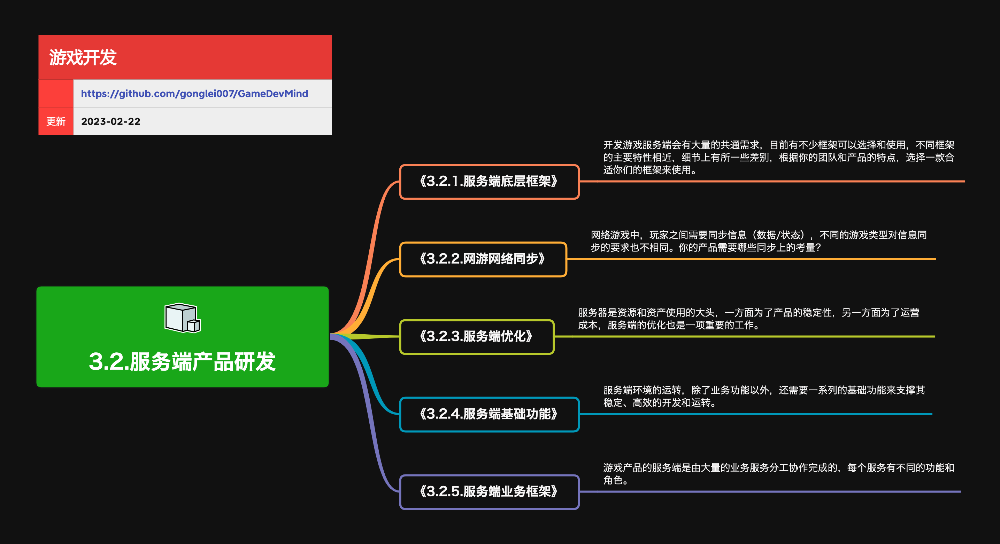

## 服务端产品研发

产品研发中跟服务端业务相关的系统。

**关键词:**  
*帐号服，游戏服，负载，容器，微服务*

**标签:** 
*等级: 高级, 阶段: 开发, 分类: 研发能力, 角色: 服务端开发*

[返回上一级](3.研发能力.md)

## 按任务找入口

| 我想解决的问题 | 先看 |
|---|---|
| 划分服务进程与职责，确定架构边界 | [服务端底层架构](3.2.1.服务端底层架构.md) |
| 角色回弹或多人状态不一致，核对预测和校正 | [网游网络同步](3.2.2.网游网络同步.md) 配套：[MOBA 角色回弹复核](../../cases/network-reconciliation.md) |
| 高并发下延迟上升，先测热点与资源开销 | [服务端优化](3.2.3.服务端优化.md) |

## 目录

<!-- BEGIN GENERATED:section-index -->
- [服务端底层架构](3.2.1.服务端底层架构.md)
- [网游网络同步](3.2.2.网游网络同步.md)
- [服务端优化](3.2.3.服务端优化.md)
- [服务端基础功能](3.2.4.服务端基础功能.md)
- [服务端业务架构](3.2.5.服务端业务架构.md)
<!-- END GENERATED:section-index -->

## 图谱

展开服务端产品研发图谱

