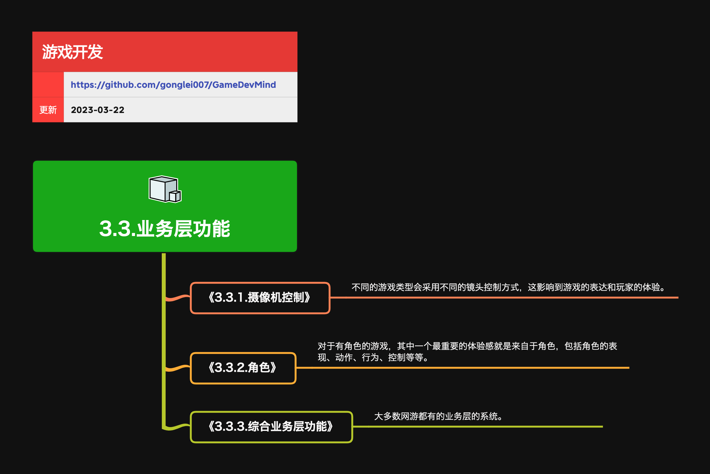

## 游戏系统与玩法研发

面向玩家体验、游戏规则和产品运行时的玩法与业务系统。这些系统会组合客户端表现、服务端权威逻辑、配置数据和运营接口，是游戏研发区别于通用软件开发最明显的部分。

**关键词:**  
*3C,游戏AI,用户系统,帐号系统,聊天系统,匹配系统,排行系统,任务系统,好友系统,成就系统,活动系统,技能系统*

**标签:** 
*等级: 中级, 阶段: 开发, 分类: 研发能力, 角色: 客户端开发|服务端开发|策划*

[返回上一级](3.研发能力.md)

## 按任务找入口

| 我想解决的问题 | 先看 |
|---|---|
| 调整跟随、切换和镜头碰撞 | [摄像机控制](3.3.1.摄像机控制.md) |
| 为 NPC 选择感知、决策和行为方式 | [游戏 AI 系统](3.3.4.游戏AI系统.md) |
| 设计登录、身份与会话流程 | [用户与帐号系统](3.3.5.用户与帐号系统.md) |

## 目录

<!-- BEGIN GENERATED:section-index -->
- [摄像机控制](3.3.1.摄像机控制.md)
- [角色](3.3.2.角色.md)
- [综合游戏系统](3.3.3.综合业务层功能.md)
- [游戏 AI 系统](3.3.4.游戏AI系统.md)
- [用户与帐号系统](3.3.5.用户与帐号系统.md)
<!-- END GENERATED:section-index -->

## 图谱

展开游戏系统与玩法研发图谱

