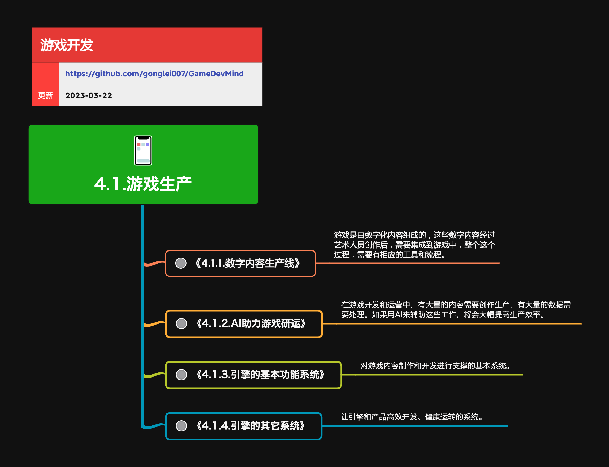

## 内容生产

游戏内容生产关注数字内容、配置数据和资产管线如何被稳定、高效地制作并进入项目。游戏引擎运行时功能属于技术能力；本模块关注内容如何被生产、检查、组织和复用。

**关键词:** 
*Qt,编辑器*

**标签:** 
*等级: 中级, 阶段: 开发, 分类: 生产能力, 角色: 客户端开发|美术*

[返回上一级](4.生产能力.md)

## 按任务找入口

| 我想解决的问题 | 先看 |
|---|---|
| 约定资产交付规格与入库流程 | [数字内容生产](4.1.1.数字内容生产.md) |
| 在内容管线里引入 AI 生产与复核 | [AI助力游戏生产](4.1.2.AI助力游戏生产.md) |

## 目录

<!-- BEGIN GENERATED:section-index -->
- [数字内容生产](4.1.1.数字内容生产.md)
- [AI助力游戏生产](4.1.2.AI助力游戏生产.md)
<!-- END GENERATED:section-index -->

## 更多资料

游戏引擎功能系统参见 [2.1.客户端技术](../2.技术能力/2.1.客户端技术.md)。

## 图谱

展开内容生产图谱

