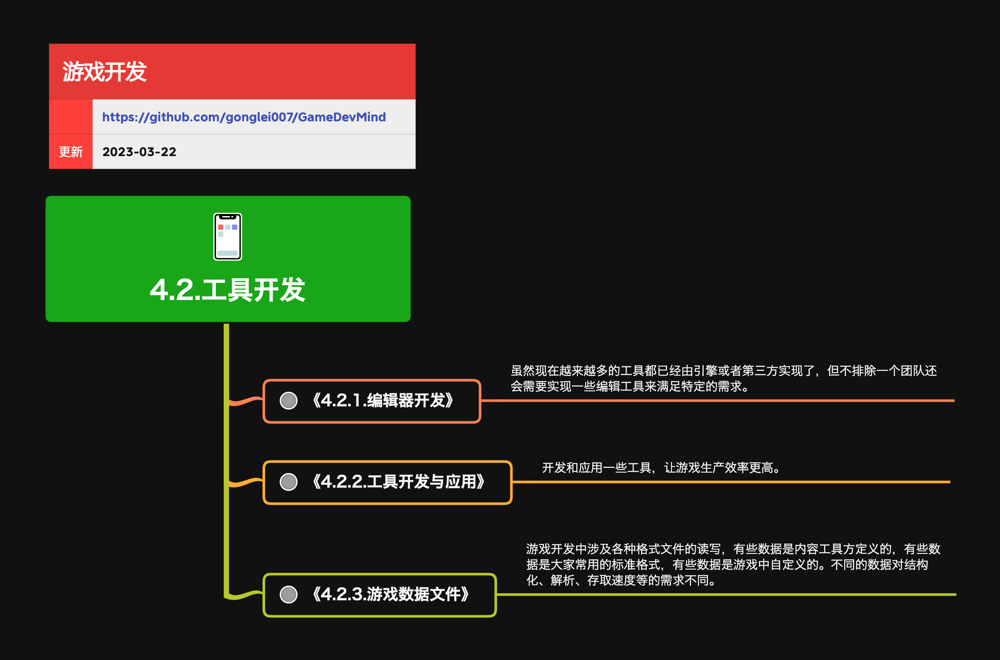

## 工具开发

有效的工具能让游戏开发过程更高效，特定的项目往往需要定制开发一些帮助生产的工具。

**关键词:** 
*游戏引擎,Unity3D,Unreal Engine,Asset,Plugin,ECS*

**标签:** 
*等级: 中级|高级, 阶段: 开发, 分类: 生产能力, 角色: 客户端开发*

[返回上一级](4.生产能力.md)

## 按任务找入口

| 我想解决的问题 | 先看 |
|---|---|
| 给策划或美术提供项目内编辑能力 | [编辑器开发](4.2.1.编辑器开发.md) |
| 把批处理、资源检查和重复操作做成工具 | [工具开发与应用](4.2.2.工具开发与应用.md) |
| 管理配置格式、版本和导入校验 | [游戏数据文件](4.2.3.游戏数据文件.md) |

## 目录

<!-- BEGIN GENERATED:section-index -->
- [编辑器开发](4.2.1.编辑器开发.md)
- [工具开发与应用](4.2.2.工具开发与应用.md)
- [游戏数据文件](4.2.3.游戏数据文件.md)
<!-- END GENERATED:section-index -->

> **分层边界：** 使用 IDE、调试器、抓包器等现成工具属于 [2.3.开发者工具箱](../2.技术能力/2.3.开发者工具箱.md)；为项目定制编辑器、数据转换、校验和自动化工具属于本模块。

## 图谱

展开工具开发图谱

