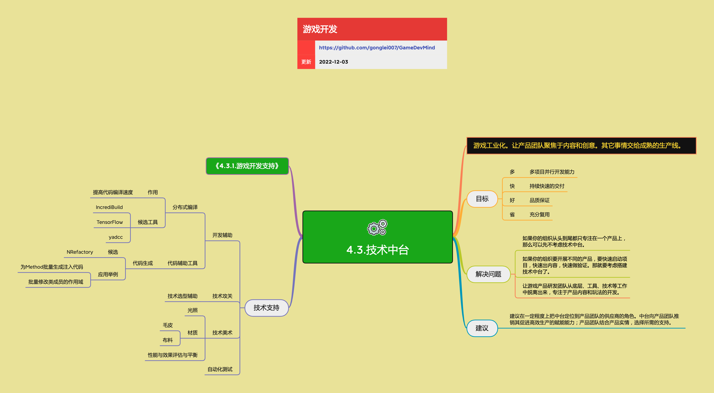

## 技术中台

游戏技术中台沉淀可复用框架、生产服务、工程规范和交付能力，让产品团队快速开启项目并聚焦内容创作和用户体验。运行时引擎技术本身归入技术能力，中台关注复用、接入和规模化生产。

**关键词:**  
*前端,后端,生产线,项目对象模型*

**标签:** 
*等级: 高级, 阶段: 开发, 分类: 生产能力, 角色: 客户端开发|服务端开发|管理*

[返回上一级](4.生产能力.md)

## 按任务找入口

| 我想解决的问题 | 先看 |
|---|---|
| 统一新项目的起步结构或复用通用模块 | [快速开发框架](4.3.1.快速开发框架.md) |
| 组织公共技术支持与项目接入 | [技术支持](4.3.2.技术支持.md) |
| 自动执行构建、测试和制品交付 | [DevOps](4.3.3.DevOps.md) |

## 目录

<!-- BEGIN GENERATED:section-index -->
- [快速开发框架](4.3.1.快速开发框架.md)
- [技术支持](4.3.2.技术支持.md)
- [DevOps](4.3.3.DevOps.md)
<!-- END GENERATED:section-index -->

## 图谱

展开技术中台图谱

