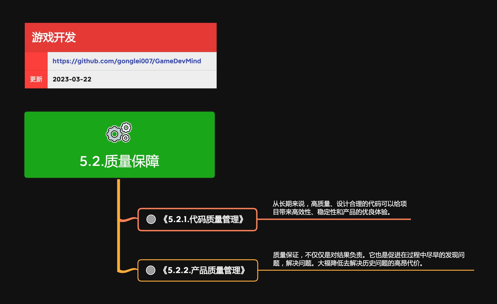

## 质量保障

质量保障，不仅仅是对结果负责。它也是促进在过程中尽早的发现问题，解决问题。大福降低去解决历史问题的高昂代价。

**关键词:**  
*QA,持续集成,Bug,单元测试*

**标签:** 
*等级: 中级, 阶段: 开发, 分类: 管理能力, 角色: 管理|测试|客户端开发|服务端开发*

[返回上一级](5.管理能力.md)

## 按任务找入口

| 我想解决的问题 | 先看 |
|---|---|
| 设置代码评审和回归门禁 | [代码质量管理](5.2.1.代码质量管理.md) |
| 制定功能与发布质量验收 | [产品质量管理](5.2.2.产品质量管理.md) |
| 识别并安排技术债修复 | [技术债务管理](5.2.3.技术债务管理.md) |

## 目录

<!-- BEGIN GENERATED:section-index -->
- [代码质量管理](5.2.1.代码质量管理.md)
- [产品质量管理](5.2.2.产品质量管理.md)
- [技术债务管理](5.2.3.技术债务管理.md)
<!-- END GENERATED:section-index -->

## 图谱

展开质量保障图谱

