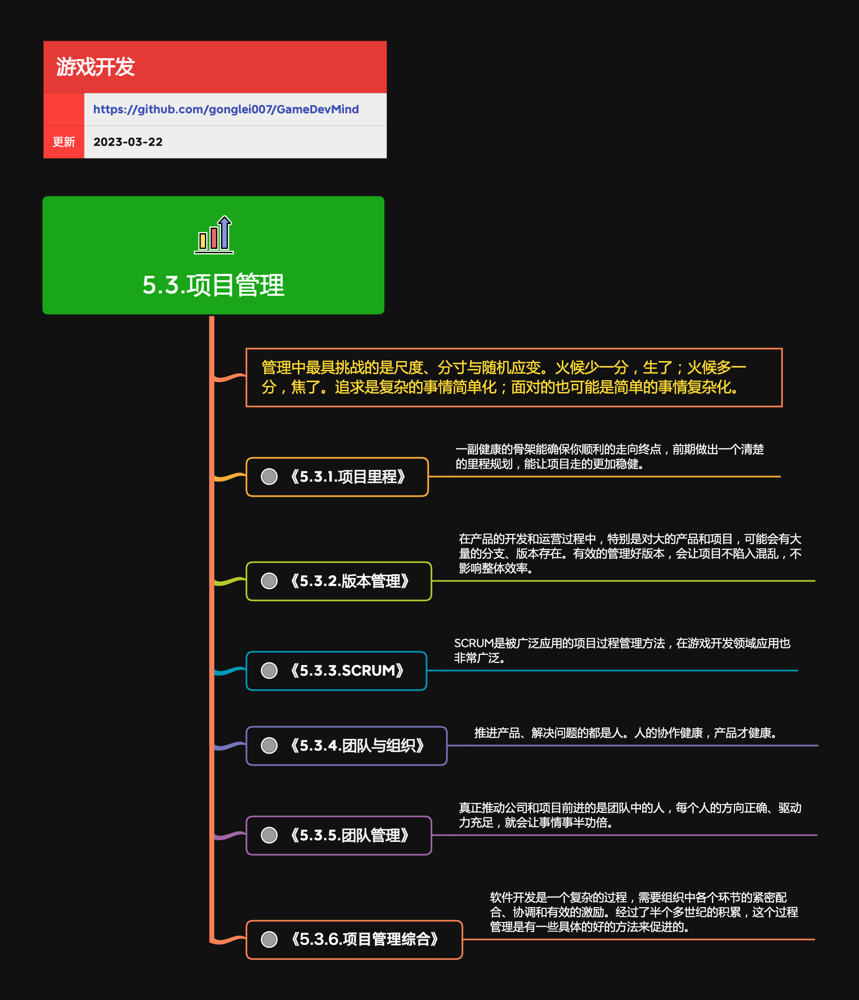

## 项目管理

管理中最具挑战的是尺度、分寸与随机应变。火候少一分，生了；火候多一分，焦了。追求是复杂的事情简单化；面对的也可能是简单的事情复杂化。

**关键词:**  
*项目管理*

**标签:** 
*等级: 中级, 阶段: 开发, 分类: 管理能力, 角色: 管理*

[返回上一级](5.管理能力.md)

## 按任务找入口

| 我想解决的问题 | 先看 |
|---|---|
| 确定里程碑、交付范围和风险 | [项目里程](5.3.1.项目里程.md) |
| 管理分支、版本与发布节奏 | [版本管理](5.3.2.版本管理.md) |
| 调整迭代会议、反馈与责任分工 | [SCRUM](5.3.3.SCRUM.md) |

## 目录

<!-- BEGIN GENERATED:section-index -->
- [项目里程](5.3.1.项目里程.md)
- [版本管理](5.3.2.版本管理.md)
- [SCRUM](5.3.3.SCRUM.md)
- [团队与组织](5.3.4.团队与组织.md)
- [团队管理](5.3.5.团队管理.md)
- [项目管理综合](5.3.6.项目管理综合.md)
<!-- END GENERATED:section-index -->

## 图谱

展开项目管理图谱

