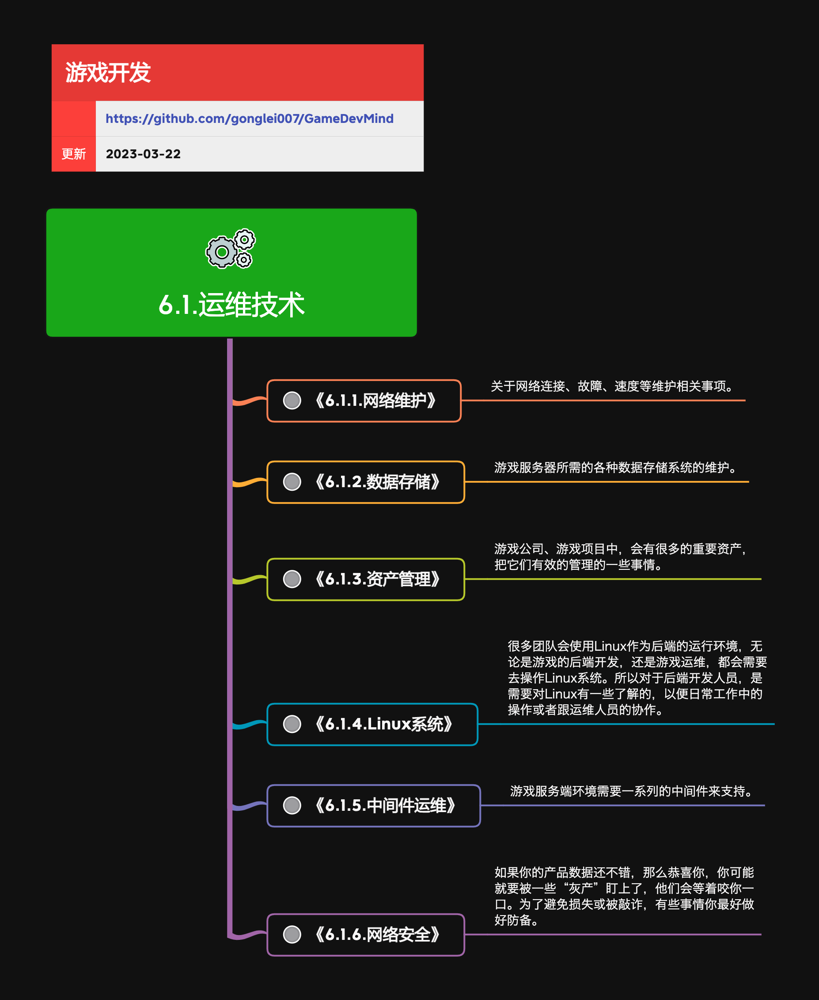

## 运维技术

产品上线后，需要一系列的运维支持和保障。这个环节是需要研发团队跟运维团队紧密沟通、配合才能完成的。这就需要双方有一些基本的共识，对一些有交集的概念，能相互沟通得清楚。

**关键词:**  
*云主机，反向代理，数据对象，数据库，消息队列*

**标签:** 
*等级: 中级, 阶段: 运营, 分类: 运营能力, 角色: 运维|服务端开发*

[返回上一级](6.运营能力.md)

## 按任务找入口

| 我想解决的问题 | 先看 |
|---|---|
| 排查线路或线上网络连接异常 | [网络维护](6.1.1.网络维护.md) |
| 核对备份、恢复和数据保留策略 | [数据存储](6.1.2.数据存储.md) |
| 处理线上主机与网络的防护问题 | [网络安全](6.1.6.网络安全.md) |

## 目录

<!-- BEGIN GENERATED:section-index -->
- [网络维护](6.1.1.网络维护.md)
- [数据存储](6.1.2.数据存储.md)
- [资产管理](6.1.3.资产管理.md)
- [Linux系统](6.1.4.Linux系统.md)
- [中间件运维](6.1.5.中间件运维.md)
- [网络安全](6.1.6.网络安全.md)
<!-- END GENERATED:section-index -->

## 图谱

展开运维技术图谱

