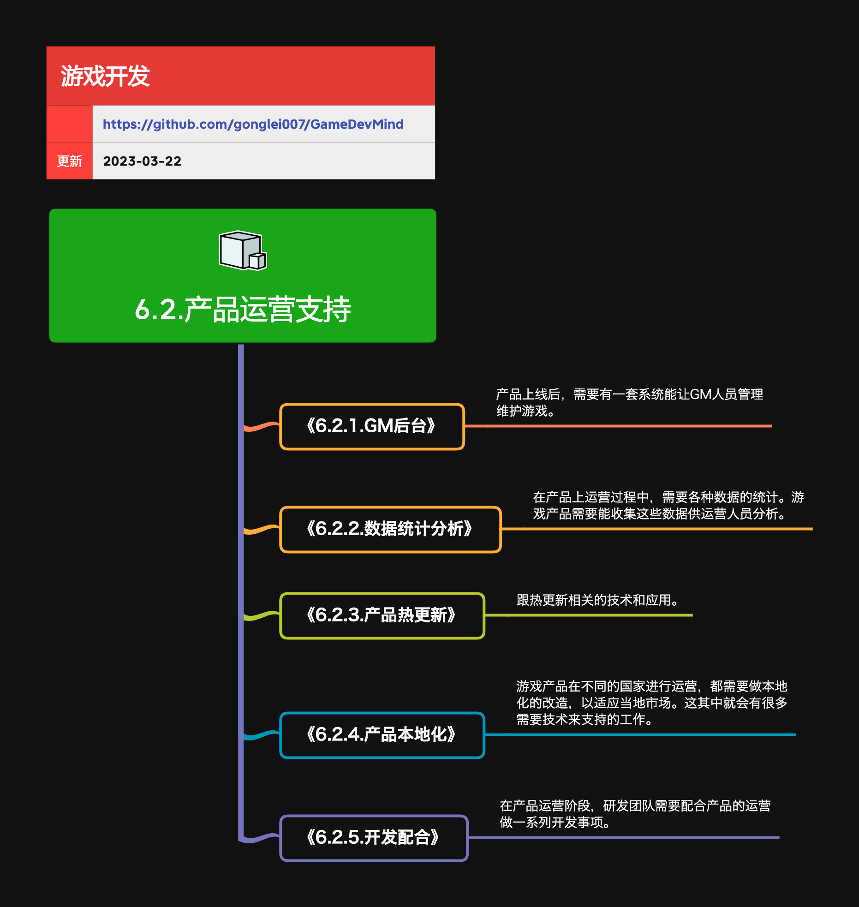

## 产品运营支持

发布出去的产品如何赚钱，全要靠运营团队的全力运作。做好配合与保障，能让大家过得都很滋润。

**关键词:**  
*分发*

**标签:** 
*等级: 中级, 阶段: 运营, 分类: 运营能力, 角色: 管理|运维|策划*

[返回上一级](6.运营能力.md)

## 按任务找入口

| 我想解决的问题 | 先看 |
|---|---|
| 支撑客服、查单和线上管理操作 | [GM后台](6.2.1.GM后台.md) |
| 定义活动指标与数据观察项 | [数据统计分析](6.2.2.数据统计分析.md) |
| 发布补丁并设计失败回退 | [产品热更新](6.2.3.产品热更新.md) 配套：[强更与登录兼容复核](../../cases/major-version-force-update.md) |
| 安排持续活动与内容更新 | [LiveOps（实时运营）](6.2.7.LiveOps.md) |

## 目录

<!-- BEGIN GENERATED:section-index -->
- [GM后台](6.2.1.GM后台.md)
- [数据统计分析](6.2.2.数据统计分析.md)
- [产品热更新](6.2.3.产品热更新.md)
- [产品本地化](6.2.4.产品本地化.md)
- [开发配合](6.2.5.开发配合.md)
- [AI助力游戏运营](6.2.6.AI助力游戏运营.md)
- [LiveOps（实时运营）](6.2.7.LiveOps.md)
<!-- END GENERATED:section-index -->

## 图谱

展开产品运营支持图谱

