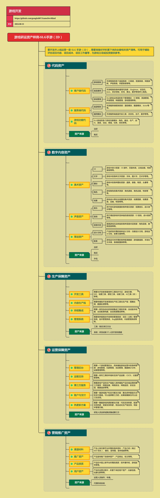

## 游戏研运资产样例-SLG手游（2D）

要开发并上线运营一款 SLG 手游（2D），需要准备好并积累下来的全套相关资产清单。可用于辅助评估项目内容、项目成本、项目工作量等，为游戏立项或投资提供参考。

**关键词:** 
*SLG, 手游, 游戏资产, 项目评估, 成本评估*

**标签:** 
*等级: 中级\|高级, 阶段: 开发\|运营, 分类: 专题内容, 角色: 管理\|策划\|客户端开发\|服务端开发*

## 图谱

---

## 概述

SLG 手游（2D）是一类以策略决策为核心、围绕城建—扩张—征服循环展开的游戏品类。相比 3D SLG，2D 版本在美术投入、客户端复杂度和包体大小上都有明显优势，适合中小团队快速验证核心玩法。本文档以一款中等体量的 2D SLG 手游为参照（类似 COK / 率土之滨的 2D 简化版），梳理从立项到上线运营所需的全套研运资产，并提供量化参考指标。

- **核心体验闭环**：城内建设 → 世界探索/扩张 → PvP/GvG 冲突 → 资源消耗 → 复投建设
- **目标平台**：iOS + Android，后期可选 PC 模拟器适配；适配低端机型（≤2GB RAM）
- **商业模式**：F2P + IAP（资源加速、外观、月卡/通行证）+ 激励广告（可选）
- **参考规模**：首版研发周期 18–24 个月，首发团队 25–35 人，项目总预算 $3M–$8M（视地区与外包比例浮动）

---

## 客户端资产

### 1. 代码框架

#### 1.1 引擎选型

引擎决定了后续开发的效率天花板和技术债务的起点。2D SLG 选型需优先考虑 UI 系统的灵活性、跨平台热更新能力、以及团队既有技术栈的匹配度。

- **Cocos Creator**：当前 2D 手游首选引擎，TypeScript 生态，UI 系统成熟，热更新支持好，社区资源丰富。学习成本低，新人两周可上手
- **Unity + 2D 模式**：适合团队同时有 3D 项目经验的场景，资源管线更强，但 2D 开箱体验不如 Cocos；包体偏大，需额外优化
- **Layabox / Egret**：国内老牌 H5 引擎，适合小游戏或轻量级立项，但工具链和社区活跃度近年下降
- **选型建议**：新项目默认推荐 Cocos Creator 3.x；团队已有成熟 Unity 框架且无包体压力可继续使用

#### 1.2 基础框架

基础框架是客户端底层基础设施，决定开发效率和可维护性。建议在立项初期投入 2–3 个月搭建，后续持续迭代。

- **资源管理**：AssetBundle / bundle 分包；支持按功能模块的懒加载和卸载；纹理压缩（ASTC/ETC2）策略
- **UI 框架**：基于状态机的 UI 栈管理（参考 MVVM）；弹窗层级管理；SafeArea 适配（刘海屏、挖孔屏）
- **网络层**：TCP 长连接（大厅/世界）+ HTTP 短连接（登录/支付/配置拉取）；protobuf 协议序列化；断线重连与消息队列
- **事件系统**：全局事件总线；模块间解耦通信；避免循环引用
- **热更新**：Lua / TypeScript 脚本热更 + 资源热更；增量更新策略（BSDiff）；版本比对与回滚机制
- **性能基座**：对象池（GameObject / 粒子）；DrawCall 合批策略；LOD 策略（即使是 2D）；帧率目标 30fps（低端机）–60fps（中高端）

#### 1.3 本地化框架

SLG 手游通常面向全球发行，从第一天起就应设计多语言/多区域支持。

- 字符串表外挂（CSV/JSON → 代码常量）；RTL 语言支持（阿拉伯语）
- 时区感知的计时系统；多币种/多支付渠道的价格表
- 区域化配置：不同地区的默认服务器、CDN、合规开关（GDPR/COPPA）

---

### 2. 游戏功能

#### 2.1 战斗系统

SLG 战斗通常以"战报"形式呈现——玩家下达指令后由服务端计算并返回结果，客户端负责播放战斗回放。

- **战斗类型**：PvE（关卡/远征/世界怪）、PvP（攻击其他玩家城市）、GvG（联盟战/据点争夺/赛季）
- **核心机制**：兵种克制（步→弓→骑→步）、英雄技能系统、士气/体力系统、阵型站位
- **客户端职责**：战斗配置表解析、战前布阵 UI、战斗中动画回放（基于战斗日志的关键帧驱动）、战后战报展示
- **配置需求**：战斗数值表 ~30–80 张；单位/英雄配置 ~50–200 条；每新增一个英雄约需策划 2–3 人天完成配置与平衡验证
- **关键考量**：战斗逻辑 100% 放在服务端，客户端仅做表现层，防止外挂篡改

#### 2.2 城建系统

城建是 SLG 的核心养成线，是玩家时间投入的主要场景，也是付费转化的关键驱动力。

- **建筑类型**（参考 20–40 种）：主城、兵营、仓库、研究所、城墙、资源田（粮/木/石/铁）、祭坛、联盟大厅等
- **建造机制**：升级队列 ×2（免费）+ 付费解锁额外队列；时间衰减加速；联盟互助加速
- **数值节奏**：单建筑等级上限 30–40 级；1–10 级快速体验（分钟级），10–20 级中期（小时级），20+ 后期（天级）；总建造线约 6–12 个月
- **美术需求**：每个建筑需 1–2 个建筑位图 + 1 套升级序列图（约 3–5 个等级变体），整体城建美术量约 40–80 套资源

#### 2.3 社交系统

社交是 SLG 留存和付费的核心驱动力，"玩的是人，不是 AI"。

- **联盟系统**：创建/加入/退出/解散（需冷却期）；联盟科技树（全盟共享加成）；联盟领土/旗帜/阵地；联盟仓库与资源互助
- **聊天系统**：世界频道、联盟频道、私聊、系统公告；敏感词过滤；翻译功能（多语言服标配）；聊天频率风控
- **好友/黑名单**：好友列表；仇敌标记；坐标书签；战报分享
- **邮件系统**：系统邮件（全服/个人）、战报邮件、资源领取邮件；邮件附件有效期（通常 7–30 天）
- **关键考量**：聊天与联盟系统是 DAU 基数保障器，需要从架构层面支持跨服/合服操作

#### 2.4 任务系统

引导玩家行为、制造目标感的核心工具，也是运营活动的基础设施。

- **主线任务**：线性推进，覆盖核心功能解锁（约 30–50 章，每章 5–10 个任务）
- **每日任务**：刷新式，活跃度积分 → 宝箱阶梯奖励（通常 5–7 个积分档位）
- **成就系统**：一次性成就 + 多级成就（如"训练 100 / 1,000 / 10,000 名士兵"），通常 80–150 项
- **限时任务**：活动期间限定任务（与运营日历联动），需要可配置的任务模板
- **配置需求**：任务条件/奖励都应表格化，方便策划热更调整；一套通用任务 DSL 可避免重复开发

#### 2.5 其他功能模块

- **新手引导**：分步强引导 + 半开放自由引导；需支持跳过/回看；通常 8–15 步引导覆盖核心循环
- **大地图/世界系统**：2D 瓦片地图（通常 1024×1024 或更大）；迷雾探索；资源点/野怪刷新；玩家城市坐标
- **背包/仓库**：道具系统（虚拟道具 ID 管理）；堆叠/拆分/合成；道具有效期管理
- **排行榜**：战力榜、联盟榜、爬塔榜、赛季积分榜；多维度刷新策略
- **商城**：直购、礼包、月卡、通行证、VIP/特权系统；限时/限量商品

---

### 3. 美术资源

2D SLG 的美术以 2D 位图 + Spine 动画为主，美术风格通常为写实或低多边形插画风。

#### 3.1 角色与英雄

- **英雄数量**：首版 40–80 个英雄，运营期按月新增 2–4 个
- **单个英雄资产**：立绘卡牌 1 张（1024×1024 或更高）、Spine 战斗小人 1 套（待机/攻击/技能/受击/死亡）、头像图标 1 张、技能图标若干
- **参考工时**：单英雄完整美术资产约 5–8 人天（含原画→拆图→Spine 动画→UI 图标）
- **兵种/士兵**：4–8 种基础兵种 × 3–5 个等级变体；每种兵种需 1 张小图标 + 战斗小人动画

#### 3.2 场景

- **城内主场景**：一张高精度背景图（2048×2048 或 4096×4096）；建筑位图叠加；日夜/季节切换（可选）
- **世界地图**：Tile 资源集（地形、山脉、河流、森林等，通常 8–16 种地形 Tile）；资源点/野怪/NPC 图标
- **战斗场景**：2–3 套战斗背景（平原、山地、攻城）；天气特效层（可选）
- **UI 场景**：登录界面、加载图、弹窗背景

#### 3.3 UI

SLG UI 是美术资产的"大头"之一，界面数量和复杂程度远高于一般手游。

- **界面数量**：预估首版 80–150 个界面（含弹窗）
- **UI 规范**：通用控件库（按钮、输入框、滚动列表、进度条、页签）；统一设计语言和颜色体系
- **图标**：道具图标 200–500 个（首版）；建筑图标 ~40 个；科技图标 ~60 个；功能入口图标 ~30 个
- **参考工时**：UI 设计资源总量约 3–6 人月（UI 设计师 ×1 × 1 个美术），不含程序实现

#### 3.4 特效

- **2D 特效**：序列帧动画（技能施放、升级闪光、获得奖励、建造完成）
- **UI 特效**：按钮点击反馈、获得奖励撒花、红点提示
- **战斗特效**：技能特效（每英雄 1–3 个）、兵种攻击/受击特效
- **制作方式**：Spine + 序列帧；DragonBones 备选；粒子编辑器（Particle2DX）
- **参考工时**：首版特效总量约 2–4 人月

---

### 4. 音频资源

音频在 SLG 中属于常被低估的沉浸感来源——从城内 BGM 到战斗音效，直接影响玩家的长期挂机体验。

- **BGM**：主城 BGM 2–3 首（不同节奏，适配前期/后期）、世界地图 BGM 1–2 首、战斗 BGM 2–3 首、联盟 BGM 1 首、登录界面 BGM 1 首；参考总量 8–12 首
- **音效（SFX）**：UI 交互音效 ~30 个（按钮、弹窗、升级）；战斗音效 ~50 个（攻击、技能、受击、阵亡）；城建音效 ~20 个（建造、完成、收获）；参考总量 100–150 个
- **配音**：英雄语音（可选，用于核心英雄，增加付费转化）；新手引导配音（可选）
- **规格**：BGM 建议 44.1kHz / 128–192kbps 循环无缝拼接；SFX 使用 OGG/WAV 单声道；音频包大小目标 ≤ 30MB（首版）
- **参考工时**：整体音频外包制作约 1–2 人月；自研需音频设计师 ×1

---

## 服务端资产

### 5. 架构与框架

SLG 服务端需要承载高并发（开服/活动高峰）、实时联盟协作、以及复杂的定时计算（资源产出、部队行军）。

- **技术选型**：Skynet (lua) / Java (Netty) / Go 为主流；国内 SLG 团队 Skynet 占比较高
- **服务拆分**：网关服（连接管理/鉴权）、大厅服（非战斗逻辑）、世界服（大地图/AOI/行军）、战斗服（战报结算）、联盟服（联盟数据/科技/GvG）、跨服服（赛季/跨服战）
- **通信协议**：TCP 长连接（protobuf 协议）+ HTTP REST（登录/支付回调/CDN 资源下载）
- **定时任务系统**：cron 调度（资源产出、部队到达、建筑完成）；需精确到秒级
- **配置管理**：策划配置表 CSV/Excel → 服务端加载；支持不停服热加载配置
- **参考规模**：服务端核心代码量 5–15 万行（依框架成熟度和团队经验浮动）

---

### 6. 核心业务

#### 6.1 帐号系统

- **注册/登录**：手机号、邮箱、第三方（Google/Apple/Facebook/微信/QQ）；游客模式 + 绑定引导
- **角色管理**：单帐号多角色（不同服务器）；角色名唯一性；改名卡/CD
- **防沉迷**：中宣部实名认证（国内版）；COPPA/GDPR 合规（海外版）
- **封禁/风控**：IP/设备指纹/行为分析 + 自动/手动封禁；申诉流程

#### 6.2 战斗计算

- **计算模式**：所有战斗在服务端"秒算"完成后返回战报；客户端仅回放帧
- **核心算法**：回合制战斗模拟（基于兵种克制、英雄技能、属性修正）；需支持最大万级单位战斗计算，单次耗时 < 100ms
- **战斗验证**：记录战斗初始状态 + 随机种子 → 可重放验证；异常日志告警
- **战报系统**：战报持久化（通常保留 7–30 天）；支持战报分享到联盟频道

#### 6.3 联盟系统

- **联盟数据**：联盟等级/科技/积分/排名/徽章
- **联盟活动**：联盟副本（全盟协作打 Boss）、联盟竞赛（积分赛/淘汰赛）、联盟领土战
- **权限管理**：盟主→副盟主→官员→精英→成员的权限分级；操作日志
- **合盟/迁移**：支持联盟合并和服务器迁移（跨区/合服的关键前置）

#### 6.4 排行榜

- **榜单类型**：战力榜、等级榜、联盟战力榜、爬塔榜、赛季积分榜、击杀榜
- **刷新策略**：实时榜（小范围 Top N）+ 定时全量刷新 + 缓存分层
- **分区维度**：本服榜 + 跨服榜 + 全球榜
- **参考实现**：Redis Sorted Set 为排行榜主力存储

---

### 7. 数据存储

SLG 的数据特性是"写多读多"——玩家行为和资源变动频繁，对数据库的写入压力大。

- **玩家数据**：MySQL / TiDB 分库分表（按 uid hash）；单服设计容量 5–10 万注册
- **缓存层**：Redis Cluster（玩家在线状态、排行榜、联盟缓存、全服计数器）
- **冷热分离**：热数据（近 30 天）在缓存/SSD；冷数据归档到廉价存储
- **数据备份**：RDB 每小时快照 + binlog 增量备份；异地容灾
- **日志数据**：战斗日志/操作日志/支付日志写入 Kafka → ClickHouse 或 Elasticsearch（用于数据分析与客服查询）

---

### 8. 运维与监控

- **服务器部署**：云服务器（阿里云/AWS/GCP）；多区域部署降低延迟
- **CI/CD**：Jenkins / GitLab CI 自动化构建与部署；灰度发布（按服务器/按 uid 尾号）
- **监控告警**：Prometheus + Grafana（服务器 CPU/内存/带宽/QPS）；Sentry/自建错误日志聚合（客户端 crash）
- **压测**：上线前全链路压测，目标并发 5,000–10,000 CCU；战斗服需单独压测峰值场景（全盟同时开战）
- **容灾**：服务无状态化设计，支持快速扩缩容；DB 主从切换 + 读写分离

---

## 运营资产

### 9. GM 后台

GM 后台是运营团队日常工作的中枢，需要兼顾效率与安全。

- **功能范围**：玩家查询（uid/角色名/设备）、资源发放、封禁/解封、邮件群发、活动配置与开关、服务器公告
- **权限分级**：超级管理员 → 运营主管 → 运营专员 → 客服，操作日志全量记录
- **工具体系**：Web 管理后台 + 命令行工具（批量操作）+ 数据面板（关键指标实时监控）
- **安全考量**：操作二次确认（重要操作）；IP 白名单；操作回滚能力
- **开发工时**：首版 GM 后台约 1–2 人月（后端 + 前端）；运营期持续迭代

---

### 10. 数据分析

从"拍脑袋"到"看数据"，是 SLG 从靠运气到可持续运营的分水岭。

- **上报体系**：客户端埋点（登录、注册、付费、关键操作）+ 服务端埋点（战斗、资源变动、系统行为）；上报协议统一规范
- **核心指标**：DAU/MAU、新增、留存（次留/7 留/30 留）、LTV、ARPPU、付费率、各系统参与率
- **分析平台**：自建 BI（Metabase/Superset）+ ClickHouse；或第三方（数数科技 ThinkingEngine / Firebase / Adjust）
- **A/B 测试**：支持按服务器/uid 分组的功能测试和数值测试
- **报表体系**：日报（核心指标快照）、周报（趋势与异常）、月度经营分析会材料
- **参考工时**：数据体系搭建约 2–3 人月（含埋点规范 + ETL + 看板）；运营期数据同事 × 1–2 人持续维护

---

### 11. 热更新

热更新能力是手游运营的"救生索"——不经商店审核即可修复线上问题或投放新内容。

- **资源热更**：美术资源、UI 布局、配置文件 → CDN 下发，客户端启动/后台切回时检查更新
- **代码热更**：Lua / TypeScript 脚本 → 差量更新（BSDiff）→ 客户端加载后生效
- **版本管理**：强更（强制更新 app 包，用于底层引擎变更）vs 弱更（热更即可，用于内容/配置变更）
- **回滚机制**：每次热更保留前一版本，支持一键回滚
- **审核策略**：热更资源发布前需走测试服验证 → 审核服 → 全服通用的灰度流程

---

### 12. 支付与帐号

支付是将游戏价值转化为商业收入的"最后一公里"，必须做到稳定、合规、多选择。

- **支付渠道**：iOS（Apple IAP）、Android（Google Play / 国内渠道 SDK：华为/小米/OPPO/vivo/应用宝）、Web 支付（微信/支付宝）
- **商品体系**：消耗品（资源包、加速道具）→ 非消耗品（永久特权、解锁功能）→ 订阅（月卡、高级通行证）
- **风控**：异常充值检测（异地 IP、短时间高频、金额异常）；退款/坏账率监控（目标 ≤ 2%）
- **帐号绑定**：支持多平台绑定/解绑；找回流程（客服工具 + 安全验证）
- **合规要求**：国内版需版号 + 中宣部实名认证；海外版需 GDPR/COPPA 弹窗；各区域税务（VAT/GST/消费税）

---

## 人员与时间估算

### 13. 团队配置建议

以下为中等体量 2D SLG 从立项到上线的核心团队配置参考（不含市场和商务岗位）。

| 职能 | 人数 | 说明 |
|------|------|------|
| **制作人/项目经理** | 1 | 全局协调、排期、对外沟通 |
| **主策划** | 1 | 核心玩法设计、数值框架、系统设计把关 |
| **系统策划** | 2–3 | 各系统详细设计、配表 |
| **数值策划** | 1–2 | 战斗数值、经济系统、成长曲线 |
| **文案策划** | 1 | 世界观、剧情、任务文本、本地化接洽 |
| **客户端主程** | 1 | 架构设计、核心模块、代码 Review |
| **客户端开发** | 3–5 | 功能模块开发、UI 实现、性能优化 |
| **服务端主程** | 1 | 架构设计、核心业务、部署方案 |
| **服务端开发** | 2–4 | 业务逻辑、数据层、工具开发 |
| **主美** | 1 | 美术风格定调、外包管理、品质把控 |
| **2D 原画/角色** | 2–3 | 英雄/角色设计、宣传图 |
| **UI 设计师** | 1–2 | 界面设计、图标、交互规范 |
| **Spine 动画** | 1–2 | 角色/兵种动画、技能特效动画 |
| **场景美术** | 1 | 城内/城外地编、世界地图 Tile |
| **音频设计师** | 1 | BGM、SFX、外包管理（可兼职/外包） |
| **QA 测试** | 2–3 | 功能测试、兼容性测试、数值验证 |
| **运营** | 1–2 | 活动策划、数据监控、社区管理（上线前 3 个月加入） |
| **合计** | **25–35** | |

- 以上为理想配置，实际可根据团队经验灵活调整——有经验的 15 人团队也可能在 24 个月内完成
- 部分职能可共用或外包：音频、部分美术（场景/图标）、部分 QA
- 运营团队上线前 3–6 个月组建，上线后逐步扩充至 5–8 人

---

### 14. 里程碑规划

| 阶段 | 时间 | 关键产出 | 里程碑检查点 |
|------|------|----------|-------------|
| **立项与预研** | M1–M3 | 市场分析报告、核心玩法文档、技术选型报告、可玩原型 | 内部 Greenlight 通过 |
| **CBT（封闭测试）版本** | M4–M9 | 核心战斗 + 城建 + 联盟 + 基础社交可玩版本 | 核心循环验证通过；留存数据达标（次留 ≥ 30%） |
| **Alpha 版本** | M10–M15 | 全部系统开发完成、美术资源到位、服务端可支撑 1,000 CCU | 功能完备性检查；内部全流程走通 |
| **Beta / 软启动** | M16–M20 | 支付接入完成、GM 后台上线、数据体系搭建；选定 1–2 个小区域软启动 | 付费率 ≥ 3%；7 留 ≥ 10%；无致命 BUG |
| **上线准备** | M21–M24 | 性能优化、兼容性测试、本地化完结、压测通过、商店物料准备 | App Store / Google Play 审核通过 |
| **全球上线** | M25+ | 正式上线运营；首周监控；紧急热更响应 | DAU、付费、服务器稳定性达标 |

- 以上为典型时间线，敏捷迭代模式下可将 Alpha 提前，软启动与部分功能开发并行
- 软启动是 SLG 最关键的验证阶段——建议至少运营 2–3 个月，积累足够的留存和付费数据后再决定是否大力推广
- 各里程碑之间应有 2–4 周 Buffer 应对不可预见的风险

---

## 更多资料

- [一站式手游创业](一站式手游创业/home.md) —— 本书的配套深度指南，覆盖从"想做"到"上线盈利"的完整闭环
- [游戏创业-手机网络游戏](./游戏创业-手机网络游戏.md) —— 按阶段拆解的创业 Checklist
- [6.运营能力/6.2.产品运营支持](6.运营能力/6.2.产品运营支持.md) —— 运营期详细介绍
- [6.运营能力/6.3.2.帐号与支付](6.运营能力/6.3.2.帐号与支付.md) —— 支付与帐号系统深入参考
- [3.研发能力/3.1.客户端产品研发](3.研发能力/3.1.客户端产品研发.md) —— 客户端研发能力参考
- 知乎专栏：[游戏开发那些事](https://www.zhihu.com/people/gong-lei) —— 作者关于游戏创业与研发的系列分享
